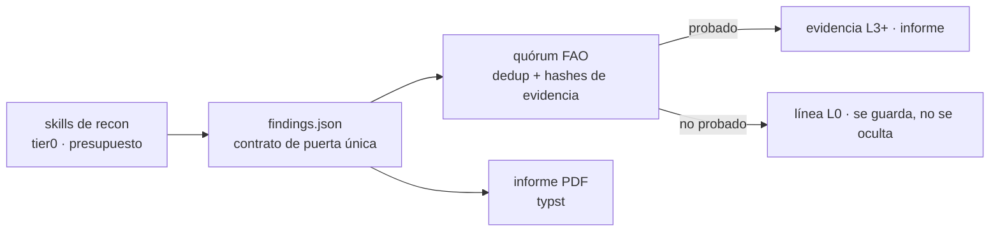

<div align="center">

# secai

**Pruebas, no afirmaciones.**

Un motor de evaluación de seguridad basado en evidencia. Skills de
detección en Python, un núcleo nativo en Rust y un único contrato de
salida estricto que ambos respetan.

*Sin prueba, no hay informe.*

[](https://github.com/maulanawirawan/secai/actions/workflows/ci.yml)
[](#qué-incluye)
[](https://github.com/maulanawirawan/secai/releases)
[](#qué-incluye)
[](#inicio-rápido)
[](#inicio-rápido)
[](LICENSE)

[English](README.md) · [中文](README.zh.md) · **Español**

</div>

---

## Úsalo desde tu agente

secai viene como un CLI de un solo comando con modos, un skill
cargable para agentes y un servidor MCP — así Claude Code, Cursor,
ZCode o cualquier agente que ejecute shell puede manejarlo directo.

```bash
git clone https://github.com/maulanawirawan/secai && cd secai
python secai.py                          # tablero de modos
python secai.py <mode> --help            # todas las opciones de un modo
claude mcp add secai -- python tools/mcp_server.py   # MCP (solo tier0)
```

Agentes: carguen [SKILL.md](SKILL.md) — el manual que enseña a un agente
a manejar secai con seguridad. Solo objetivos autorizados; sin prueba,
sin reporte.

## Por qué existe

La mayoría de los escáneres te entregan cientos de hallazgos "posibles"
y el resto es problema tuyo. Luego el equipo de triage rechaza el
informe con un *"impacto no demostrado"*, y, siendo sinceros, tienen
razón.

secai va en la dirección contraria. **Un hallazgo que no puedes probar
es una pista, no una afirmación.** Cada resultado ocupa un lugar en una
escalera de evidencia explícita. Si una herramienta produce una salida
mal formada, la ejecución se detiene en vez de seguir en silencio. Y una
pista solo sube de nivel cuando fuentes independientes coinciden.

El resultado es un informe más corto que de verdad puedes defender.

## Para qué sirve

secai es un proyecto público y abierto construido para trabajo de seguridad real. Usos típicos:

- **Bug bounty y VDP** — enumera la superficie de ataque (headers, CORS,
  GraphQL, docs de API, exposición, cookies) y obtén veredictos que
  sobreviven al triaje, no una muralla de "posibles problemas".
- **Pentest de tus propios proyectos** — apunta las habilidades a tu build
  de staging/local antes de publicar y atrapa lo básico: headers faltantes,
  páginas de debug, archivos filtrados, endpoints sin auth, CORS permisivo.
- **Integrar seguridad en tu pipeline** — el contrato findings.json y
  `secai validate` hacen la salida amigable para CI; el núcleo Rust habla
  el mismo contrato.
- **Aprender** — el lab objetivo incluido más `docs/AWARENESS-PATTERNS.md`
  (nueve patrones reales rastreados de principio a fin) son un aula práctica.

Quédate en el carril: solo objetivos autorizados, y las estrictas compuertas
del nivel de prueba son parte del diseño, no un obstáculo.

## Míralo razonar

Apunta una skill al objetivo de laboratorio incluido y fíjate en los
veredictos, no en un montón de "hallazgos". Esta es salida real, copiada
tal cual (las herramientas imprimen en indonesio: `temuan` = hallazgos,
`AMAN` = limpio, `request` = peticiones):

```console
$ python tools/lab_target.py
lab target aktif: http://127.0.0.1:8777

$ python skills/http_security_headers.py \
    --url http://127.0.0.1:8777/api/products --from-raw raw.txt \
    --out headers.json
http-security-headers: 8 temuan (2 AMAN) (0 request) -> headers.json

$ secai validate headers.json
OK: 8 findings valid terhadap kontrak (headers.json)
```

Ahora mira qué hay de verdad en `headers.json`: cada fila lleva su
propio veredicto:

```
L1 SUSPECTED   low    Security header absent: Content-Security-Policy    reportable: false
L1 SUSPECTED   low    Security header absent: X-Frame-Options            reportable: false
L1 SUSPECTED   low    Security header absent: X-Content-Type-Options     reportable: false
L1 SUSPECTED   info   Security header absent: Referrer-Policy            reportable: false
L1 SUSPECTED   info   Security header absent: Permissions-Policy         reportable: false
L0 OBSERVED    info   No version leak via Server                         reportable: false
L0 OBSERVED    info   No version leak via X-Powered-By                   reportable: false
L1 SUSPECTED   low    Security headers posture: 0/5 present              reportable: false
```

Fíjate en lo que *no* pasó: nada se llamó vulnerabilidad. Son pistas
`L1` y líneas `L0` ("revisado, sin hallazgos"), cada una marcada como
`reportable: false`, porque ninguna está probada todavía. Ese es justo
el punto.

## La escalera de evidencia

| Nivel | Significado | ¿Va al informe? |
|---|---|---|
| `L-x` | REJECTED: falso positivo demostrado | no |
| `L0` | OBSERVED: revisado, sin hallazgos | no |
| `L1` | SUSPECTED: pista de inventario o postura | no |
| `L2` | REPRODUCED: la pista se reproduce | no |
| `L3` | DETERMINISTICALLY VERIFIED: PoC funcional | ✅ |
| `L4` | IMPACT VERIFIED: acceso a un objeto que no es tuyo | ✅ |
| `L5` | BLIND VALIDATED: confirmado por un tercero | ✅ |

Solo `L3` o superior llega a un informe. Todo lo demás es registro de
trabajo: qué revisaste y qué mostró.



## Qué incluye

- **92 skills de detección** en `skills/` para recon, postura y
  exposición. Cada una es una CLI independiente con una clase de
  seguridad declarada (de `read-only` a `state-changing`) y un límite
  estricto de peticiones derivado de ella. El registro es una lista
  blanca: lo que no está listado no se ejecuta.
- **Un núcleo nativo en Rust** en `core-rs/`: `secai validate` revisa
  el contrato, `secai scan` ejecuta escaneos por niveles y genera el
  informe PDF. También se encarga de la correlación FAO (dedup, quórum,
  hashes de evidencia) y de un presupuesto de peticiones que falla
  cerrado.
- **Un contrato, dos lenguajes.** `findings.json` está implementado en
  Python y en Rust, y ambos se prueban entre sí.
- **Inteligencia que se actualiza sola** desde CISA KEV, NVD y OSV, para
  que la detección de CVE no quede desfasada.
- **Mapa de código.** Apúntalo a un repositorio y genera un
  `attack-surface.json` (rutas, flags de autenticación, manejadores de
  subida) sin peticiones y sin ejecutar código, y luego enlaza las
  pistas con `file:line`.
- **Ejecuciones nocturnas.** Escaneos programados con detección de
  cambios: pistas nuevas, evidencia debilitada y veredictos que cambian
  se registran por programa.
- **Servidor MCP** para manejar secai desde Claude Code, Cursor o
  cualquier cliente MCP.
- **Un nivel de prueba bloqueado** (`tools/exploit_*`) para convertir
  pistas `L1`/`L2` en `L3`/`L4` con PoC reproducibles. Está apagado
  salvo que el objetivo se marque explícitamente con `exploit_allowed`,
  está pensado para laboratorios y staging, y algunas técnicas (DoS,
  persistencia, gusanos, simulación de ransomware, exfiltración masiva)
  se rechazan sin importar los flags. Detalles en
  [docs/EXPLOIT-TIER.md](docs/EXPLOIT-TIER.md).

¿Usas un agente de IA para programar? Apúntalo a
[AGENTS.md](AGENTS.md). Ahí explica cómo compilar, probar y añadir una
skill.

## Mapa de capacidades

La familia de triaje son CLIs offline independientes: entra evidencia (logs, exportaciones, manifiestos, binarios), sale un findings.json determinístico, fail-closed, sin red. Aspectos por dominio:

<details>
<summary><b>96 herramientas portadas en 9 dominios (175 en total en tools/) — clic para expandir</b></summary>
<br>

| Dominio | Responde a… | Ejemplos |
|:---|:---|:---|
| Triaje de eventos Windows | quién se mueve lateralmente / persiste / vuelca credenciales? | `sysmon_triage`, `win_persist_triage`, `dcsync_triage`, `ps_scriptlog_triage` |
| Hardening Linux y host | está este host endurecido / con backdoor / escalable? | `linux_cis_audit`, `linux_persist_scan`, `linux_privesc_audit`, `aide_change_triage` |
| Config cloud y contenedores | está expuesto este bucket / rol / pod / función? | `aws_config_audit`, `gcp_fw_audit`, `k8s_podsec_audit`, `netpol_audit`, `lambda_config_audit` |
| Web, API y OAuth | es este spec/flujo/redirect/token explotable? | `openapi_spec_audit`, `graphql_depth_audit`, `oauth_redirect_audit`, `jwt_token_audit` |
| Malware y binarios | qué puede hacer este binario/documento y qué lleva incrustado? | `pe_import_scan`, `rust_binary_triage`, `crypto_constant_scan`, `stego_triage`, `sqlite_forensics` |
| Secretos y datos | qué se filtró, dónde y cuán grave es? | `paste_triage`, `secret_report_ingest`, `data_class_scan`, `browser_history_triage` |
| Supply chain y CI/CD | se puede confiar en este pipeline/provenance? | `gha_workflow_audit`, `slsa_provenance_audit`, `pkg_typosquat_check`, `sarif_ingest` |
| Gestión de vulnerabilidades | qué se corrige primero y por qué? | `ssvc_triage`, `owasp_risk_rating`, `attack_coverage`, `kev_gap` |
| Validación e informes | es real este hallazgo y cómo se comunica? | `verify_gate`, `brocards_triage`, `log_chain_verify`, `report_pack` |

</details>

El índice completo está en [CHANGELOG.md](CHANGELOG.md); la metodología destilada de conceptos no-tool (250 secciones) en [docs/PORT-AGENT-METHODS.md](docs/PORT-AGENT-METHODS.md).

## Comandos

| Comando | Qué hace |
|:---|:---|
| `secai scan --domain example.com --max-requests 32 --report` | Escaneo tier0 completo (datos públicos, presupuesto estricto) + informe PDF |
| `secai validate findings.json` | Verifica cualquier findings.json contra el contrato (núcleo Rust) |
| `secai merge --dedup-id ...` | Fusiona y deduplica conjuntos de hallazgos (correlación FAO) |
| `python skills/<skill>.py --url … --out f.json` | Ejecuta una skill de detección (93 disponibles, allowlist) |
| `python tools/code_map.py --repo <path> --out surface.json` | Mapea código fuente a superficie de ataque — cero peticiones |
| `python tools/chain_planner.py --findings f.json` | Planifica cadenas de explotación A→B→C desde hallazgos |
| `python tools/submission_gate.py --finding f.json --program p.json` | Compuerta de 7 preguntas antes de enviar un hallazgo |
| `claude mcp add secai -- python tools/mcp_server.py` | Controla secai desde Claude Code / cualquier cliente MCP |
| `python tools/lab_target.py` | Levanta un laboratorio local para practicar |

Night runs (escaneos programados con detección de drift) y sync de intel (CISA KEV / NVD / OSV) están en [docs/](docs/).

## Inicio rápido

```bash
# compilar el núcleo nativo
cargo build --release --manifest-path core-rs/Cargo.toml

# ejecutar una skill
python skills/banner_posture.py --url https://example.com --out banner.json

# validar la salida contra el contrato
core-rs/target/release/secai validate banner.json

# escaneo tier0 completo (solo datos públicos, presupuesto estricto) + informe PDF
core-rs/target/release/secai scan --domain example.com \
    --max-requests 32 --out findings/scan --report
```

¿Quieres algo seguro para practicar? `python tools/lab_target.py`
levanta un objetivo de laboratorio local. Más notas de instalación en
[docs/INSTALL.md](docs/INSTALL.md).

### Mapa de código

```bash
# mapear el código de un repo a una superficie de ataque (sin peticiones)
python tools/code_map.py --repo <path> --out surface.json --reconcile f.json
```

## Reglas de diseño

La parte aburrida, que también es la importante.

- **Contrato de puerta única.** Todas las herramientas escriben la misma
  forma de `findings.json`. Una salida mal formada hace fallar la
  ejecución.
- **Clases de seguridad y lista blanca.** tier0 solo ejecuta las clases
  suaves. Si una skill no está en el registro, no se ejecuta.
- **Batería de regresión de falsos positivos.** FP1 a FP16 más guardas
  por clase forman parte de la suite de tests. Si un endpoint de control
  "falla" de la misma forma, la afirmación se cancela en vez de
  confirmarse.
- **Tráfico saliente honesto.** secai se identifica tal cual por
  defecto. Puedes usar `--ua` o `--proxy` (las credenciales se ocultan),
  pero no hay funciones de evasión, a propósito.
- **Manifiesto de ejecución.** Cada artefacto de una ejecución tiene su
  sha256, así la cadena de evidencia se puede verificar meses después.

## Estructura del repo

```
core/findings.py   el contrato, lado Python
core-rs/           núcleo nativo: contrato, orquestador, FAO, serve
skills/            92 skills de detección + registry.json (lista blanca)
tools/             planificador, mapa de código, ejecuciones nocturnas,
                   sync de intel, informe PDF, servidor MCP,
                   nivel de prueba bloqueado, objetivo de laboratorio
tests/             suite Python, con regresión de FP y tests de guarda
lab/               sitio de laboratorio sintético local
docs/              instalación, egress, nocturnas, intel, política del nivel de prueba
Dockerfile         imagen ligera
```

## Servidor MCP

```bash
pip install "mcp[cli]"
```

```json
{
  "mcpServers": {
    "secai": {
      "command": "python",
      "args": ["tools/mcp_server.py"]
    }
  }
}
```

Expone `secai_list_skills` y `secai_run_skill`. Las clases solo de
laboratorio nunca se exponen, y cada resultado se valida contra el
contrato antes de devolvértelo.

## Preguntas frecuentes

**¿Es un escáner de vulnerabilidades?**
En parte. tier0 es un motor de recon y postura con presupuesto, y es lo
que más gente usará. Lo más interesante viene después: decidir qué está
realmente probado y qué sigue siendo una suposición.

**¿Por qué la salida tiene tantas líneas de "no probado"?**
Es intencional. Una revisión que no probó nada queda registrada como
línea `L0` en vez de desaparecer. Los falsos positivos nacen de los
saltos silenciosos.

**¿Puedo usar el nivel de prueba en producción?**
Por favor, no. La herramienta lo convierte en una decisión consciente:
tienes que activar `exploit_allowed` por objetivo, y cualquier cosa
destructiva necesita tres llaves independientes más la confirmación de
un snapshot.

## Desarrollo

```bash
python -m pytest tests/ -q
cargo test --release --manifest-path core-rs/Cargo.toml
```

Los tests de guarda mantienen a ambos lenguajes alineados: etiquetas de
veredicto, IDs de hallazgos, formas de retorno `(rows, meta)`, aridad de
llamadas, nada de user agents fijos en el código y la batería completa
de regresión de FP.

## Uso responsable

secai es solo para pruebas **autorizadas**: tus propios sistemas o
programas que te den permiso claro. Escanear sistemas ajenos sin permiso
es ilegal en la mayoría de los lugares. No lo hagas.

## Comunidad

🐛 **¿Encontraste un bug?** → [reporte de bug](.github/ISSUE_TEMPLATE/bug_report.md)
🙅 **¿Un detector marcó algo benigno?** → [reporte de falso positivo](.github/ISSUE_TEMPLATE/false_positive.md) — los FP son ciudadanos de primera clase aquí; cada uno endurece el suelo anti-FP
💡 **Falta una capacidad?** → [solicitud de función](.github/ISSUE_TEMPLATE/feature_request.md)
🔒 **¿Problema de seguridad en secai mismo?** → [SECURITY.md](.github/SECURITY.md) (divulgación privada, sin issue público)
🤝 [Guía de contribución](CONTRIBUTING.md) · [Código de conducta](.github/CODE_OF_CONDUCT.md) · [Changelog](CHANGELOG.md)

## Contribuir

Los PR son bienvenidos: arreglos, nuevas skills de detección,
documentación, erratas. Empieza por
[CONTRIBUTING.md](CONTRIBUTING.md). Un PR aceptado te pone en la lista
de contribuidores.

Si secai te ahorra tiempo, una ⭐ ayuda a que otros lo encuentren.

## Star History

[](https://star-history.com/#maulanawirawan/secai&Date)

## Créditos

- [Agentic-Bug-Hunter](https://github.com/awarexone/Agentic-Bug-Hunter) (MIT) — fuente de conceptos del mini-programa scope/chain/web3/memoria/informe (`scope_gate`, `chain_planner`, `solidity_static_audit`, `hunt_pattern_db`, etc.).
- El programa de 995 conceptos usó cuatro colecciones públicas de skills de seguridad (trailofbits/skills, SnailSploit/Claude-Red, mukul975/Anthropic-Cybersecurity-Skills, NVIDIA-SkillSpector) — cada herramienta se construyó from-scratch con atribución de concepto en su docstring.

## Licencia

[PolyForm Noncommercial 1.0.0](LICENSE). Libre para usar, estudiar,
modificar y compartir con fines **no comerciales**.

¿Quieres usarlo comercialmente, por ejemplo dentro de un servicio de
pago? También se puede, solo pregunta primero y acordamos una licencia.
Abre un [issue](https://github.com/maulanawirawan/secai/issues) o
escribe a [@maulanawirawan](https://github.com/maulanawirawan).

Los componentes y fuentes de datos de terceros se acreditan en
[THIRD-PARTY-NOTICES.md](THIRD-PARTY-NOTICES.md).
