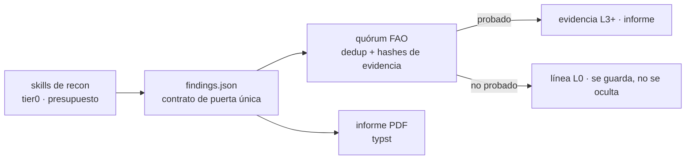

<div align="center">

# cyphron

**Pruebas, no afirmaciones.**

Un motor de evaluación de seguridad basado en evidencia. Skills de
detección en Python, un núcleo nativo en Rust y un único contrato de
salida estricto que ambos respetan.

*No exploit, no report.*

[](https://github.com/maulanawirawan/cyphron/actions/workflows/ci.yml)
[](#desarrollo)
[](https://github.com/maulanawirawan/cyphron/releases)
[](#qué-incluye)
[](#inicio-rápido)
[](#inicio-rápido)
[](LICENSE)

[English](README.md) · [Bahasa Indonesia](README.id.md) · [中文](README.zh.md) · **Español**

</div>

---

## Por qué existe

La mayoría de los escáneres te entregan cientos de hallazgos "posibles"
y el resto es problema tuyo. Luego el equipo de triage rechaza el
informe con un *"impacto no demostrado"*, y, siendo sinceros, tienen
razón.

cyphron va en la dirección contraria. **Un hallazgo que no puedes probar
es una pista, no una afirmación.** Cada resultado ocupa un lugar en una
escalera de evidencia explícita. Si una herramienta produce una salida
mal formada, la ejecución se detiene en vez de seguir en silencio. Y una
pista solo sube de nivel cuando fuentes independientes coinciden.

El resultado es un informe más corto que de verdad puedes defender.

## La escalera de evidencia

| Nivel | Significado | ¿Va al informe? |
|---|---|---|
| `L-x` | REJECTED: falso positivo demostrado | no |
| `L0` | OBSERVED: revisado, sin hallazgos | no |
| `L1` | SUSPECTED: pista de inventario o postura | no |
| `L2` | REPRODUCED: la pista se reproduce | no |
| `L3` | DETERMINISTICALLY VERIFIED: PoC funcional | ✅ |
| `L4` | IMPACT VERIFIED: acceso a un objeto que no es tuyo | ✅ |
| `L5` | BLIND VALIDATED: confirmado por un tercero | ✅ |

Solo `L3` o superior llega a un informe. Todo lo demás es registro de
trabajo: qué revisaste y qué mostró.



## Qué incluye

- **92 skills de detección** en `skills/` para recon, postura y
  exposición. Cada una es una CLI independiente con una clase de
  seguridad declarada (de `read-only` a `state-changing`) y un límite
  estricto de peticiones derivado de ella. El registro es una lista
  blanca: lo que no está listado no se ejecuta.
- **Un núcleo nativo en Rust** en `core-rs/`: `cyphron validate` revisa
  el contrato, `cyphron scan` ejecuta escaneos por niveles y genera el
  informe PDF. También se encarga de la correlación FAO (dedup, quórum,
  hashes de evidencia) y de un presupuesto de peticiones que falla
  cerrado.
- **Un contrato, dos lenguajes.** `findings.json` está implementado en
  Python y en Rust, y ambos se prueban entre sí.
- **Inteligencia que se actualiza sola** desde CISA KEV, NVD y OSV, para
  que la detección de CVE no quede desfasada.
- **Mapa de código.** Apúntalo a un repositorio y genera un
  `attack-surface.json` (rutas, flags de autenticación, manejadores de
  subida) sin peticiones y sin ejecutar código, y luego enlaza las
  pistas con `file:line`.
- **Ejecuciones nocturnas.** Escaneos programados con detección de
  cambios: pistas nuevas, evidencia debilitada y veredictos que cambian
  se registran por programa.
- **Servidor MCP** para manejar cyphron desde Claude Code, Cursor o
  cualquier cliente MCP.
- **Un nivel de prueba bloqueado** (`tools/exploit_*`) para convertir
  pistas `L1`/`L2` en `L3`/`L4` con PoC reproducibles. Está apagado
  salvo que el objetivo se marque explícitamente con `exploit_allowed`,
  está pensado para laboratorios y staging, y algunas técnicas (DoS,
  persistencia, gusanos, simulación de ransomware, exfiltración masiva)
  se rechazan sin importar los flags. Detalles en
  [docs/EXPLOIT-TIER.md](docs/EXPLOIT-TIER.md).

¿Usas un agente de IA para programar? Apúntalo a
[AGENTS.md](AGENTS.md). Ahí explica cómo compilar, probar y añadir una
skill.

## Inicio rápido

```bash
# compilar el núcleo nativo
cargo build --release --manifest-path core-rs/Cargo.toml

# ejecutar una skill
python skills/banner_posture.py --url https://example.com --out banner.json

# validar la salida contra el contrato
core-rs/target/release/cyphron validate banner.json

# escaneo tier0 completo (solo datos públicos, presupuesto estricto) + informe PDF
core-rs/target/release/cyphron scan --domain example.com \
    --max-requests 32 --out findings/scan --report
```

¿Quieres algo seguro para practicar? `python tools/lab_target.py`
levanta un objetivo de laboratorio local. Más notas de instalación en
[docs/INSTALL.md](docs/INSTALL.md).

### Mapa de código

```bash
# mapear el código de un repo a una superficie de ataque (sin peticiones)
python tools/code_map.py --repo <path> --out surface.json --reconcile f.json
```

## Reglas de diseño

La parte aburrida, que también es la importante.

- **Contrato de puerta única.** Todas las herramientas escriben la misma
  forma de `findings.json`. Una salida mal formada hace fallar la
  ejecución.
- **Clases de seguridad y lista blanca.** tier0 solo ejecuta las clases
  suaves. Si una skill no está en el registro, no se ejecuta.
- **Batería de regresión de falsos positivos.** FP1 a FP16 más guardas
  por clase forman parte de la suite de tests. Si un endpoint de control
  "falla" de la misma forma, la afirmación se cancela en vez de
  confirmarse.
- **Tráfico saliente honesto.** cyphron se identifica tal cual por
  defecto. Puedes usar `--ua` o `--proxy` (las credenciales se ocultan),
  pero no hay funciones de evasión, a propósito.
- **Manifiesto de ejecución.** Cada artefacto de una ejecución tiene su
  sha256, así la cadena de evidencia se puede verificar meses después.

## Estructura del repo

```
core/findings.py   el contrato, lado Python
core-rs/           núcleo nativo: contrato, orquestador, FAO, serve
skills/            92 skills de detección + registry.json (lista blanca)
tools/             planificador, mapa de código, ejecuciones nocturnas,
                   sync de intel, informe PDF, servidor MCP,
                   nivel de prueba bloqueado, objetivo de laboratorio
tests/             suite Python, con regresión de FP y tests de guarda
lab/               sitio de laboratorio sintético local
docs/              instalación, egress, nocturnas, intel, política del nivel de prueba
Dockerfile         imagen ligera
```

## Servidor MCP

```bash
pip install "mcp[cli]"
```

```json
{
  "mcpServers": {
    "cyphron": {
      "command": "python",
      "args": ["tools/mcp_server.py"]
    }
  }
}
```

Expone `cyphron_list_skills` y `cyphron_run_skill`. Las clases solo de
laboratorio nunca se exponen, y cada resultado se valida contra el
contrato antes de devolvértelo.

## Preguntas frecuentes

**¿Es un escáner de vulnerabilidades?**
En parte. tier0 es un motor de recon y postura con presupuesto, y es lo
que más gente usará. Lo más interesante viene después: decidir qué está
realmente probado y qué sigue siendo una suposición.

**¿Por qué la salida tiene tantas líneas de "no probado"?**
Es intencional. Una revisión que no probó nada queda registrada como
línea `L0` en vez de desaparecer. Los falsos positivos nacen de los
saltos silenciosos.

**¿Puedo usar el nivel de prueba en producción?**
Por favor, no. La herramienta lo convierte en una decisión consciente:
tienes que activar `exploit_allowed` por objetivo, y cualquier cosa
destructiva necesita tres llaves independientes más la confirmación de
un snapshot.

## Desarrollo

```bash
python -m pytest tests/ -q
cargo test --release --manifest-path core-rs/Cargo.toml
```

Los tests de guarda mantienen a ambos lenguajes alineados: etiquetas de
veredicto, IDs de hallazgos, formas de retorno `(rows, meta)`, aridad de
llamadas, nada de user agents fijos en el código y la batería completa
de regresión de FP.

## Uso responsable

cyphron es solo para pruebas **autorizadas**: tus propios sistemas o
programas que te den permiso claro. Escanear sistemas ajenos sin permiso
es ilegal en la mayoría de los lugares. No lo hagas.

## Contribuir

Los PR son bienvenidos: arreglos, nuevas skills de detección,
documentación, erratas. Empieza por
[CONTRIBUTING.md](CONTRIBUTING.md). Un PR aceptado te pone en la lista
de contribuidores.

Si cyphron te ahorra tiempo, una ⭐ ayuda a que otros lo encuentren.

## Licencia

[PolyForm Noncommercial 1.0.0](LICENSE). Libre para usar, estudiar,
modificar y compartir con fines **no comerciales**.

¿Quieres usarlo comercialmente, por ejemplo dentro de un servicio de
pago? También se puede, solo pregunta primero y acordamos una licencia.
Abre un [issue](https://github.com/maulanawirawan/cyphron/issues) o
escribe a [@maulanawirawan](https://github.com/maulanawirawan).

Los componentes y fuentes de datos de terceros se acreditan en
[THIRD-PARTY-NOTICES.md](THIRD-PARTY-NOTICES.md).
