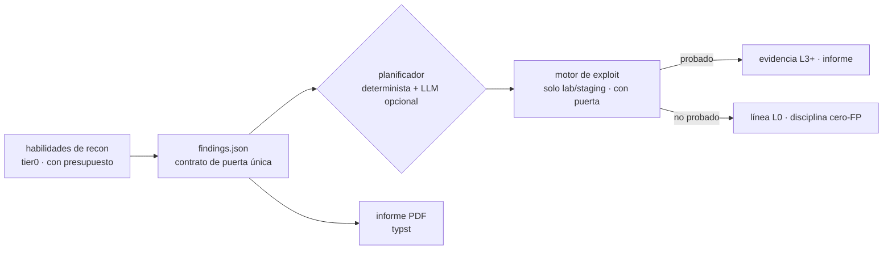

<div align="center">

# cyphron

**Pruebas, no afirmaciones.** Un motor de evaluación de seguridad basado
en evidencia — habilidades Python impulsadas por un núcleo Rust nativo,
un contrato estricto, cero falsos positivos por diseño.

*No exploit, no report.*

[](#desarrollo)
[](https://github.com/maulanawirawan/cyphron/actions/workflows/ci.yml)
[](LICENSE)
[](#inicio-rápido)
[](#inicio-rápido)
[](#qué-incluye)

[English](README.md) · [Bahasa Indonesia](README.id.md) · [中文](README.zh.md) · **Español**

</div>

---

## Por qué existe cyphron

La mayoría de los escáneres te entregan un muro de hallazgos sin
verificar y te desean suerte. Los equipos de triage rechazan esos
informes — *"demonstrated impact is not clear"* — y, siendo honestos,
tienen razón.

cyphron optimiza justo lo contrario: **un hallazgo que no puedes probar
es una pista, no una afirmación.** Cada línea lleva un veredicto en una
escalera de evidencia explícita, la salida malformada detiene la
ejecución en vez de pasar en silencio, y la correlación entre herramientas
solo asciende una pista cuando fuentes independientes coinciden.

## La escalera de evidencia

| Nivel | Significado | ¿Reportable? |
|---|---|---|
| `L-x` | RECHAZADO (falso positivo probado) | — |
| `L0` | OBSERVED — verificado, sin hallazgos | no |
| `L1` | SUSPECTED — pista de inventario/postura | no |
| `L2` | REPRODUCED — pista reproducible | no |
| `L3` | DETERMINISTICALLY VERIFIED — PoC | ✅ |
| `L4` | IMPACT VERIFIED — objeto ajeno leído | ✅ |
| `L5` | BLIND VALIDATED — confirmado por terceros | ✅ |

Solo `L3+` puede aparecer en un informe. Todo lo demás es disciplina
interna: qué se comprobó y qué demostró.



## Qué incluye

- **75 habilidades en el registro** (recon, postura, exposición) — cada
  una con una clase de seguridad explícita (`read-only` →
  `state-changing`) y un presupuesto de peticiones derivado de ella.
- **38 playbooks de exploit** — IDOR, SQLi (booleana/error/tiempo),
  SSRF + cadena, XXE (OOB + fichero en línea), deserialización, JNDI,
  polución de prototipos, cache deception **y cache poisoning**, JWT
  (secreto débil + confusión de algoritmo), CRLF, enumeración de
  usuarios (reset + registro), fijación de sesión + sesión que no muere
  tras logout, lockout, OAuth state, envenenamiento de Host header,
  marcador RCE, IDOR masivo, regresión de auth entre versiones de API…
  Cada playbook incluye un **control de endpoint seguro** — si el control
  también "falla", la afirmación se descarta.
- **Sandbox Docker** — el motor corre en un contenedor efímero
  endurecido (rootfs de solo lectura, cap-drop ALL, red interna, sin
  internet). Los 38 playbooks están probados de extremo a extremo
  *dentro* de ese sandbox — 140 peticiones, cero tráfico externo.
- **Planificador de ataques** — núcleo determinista por defecto (cero
  peticiones, cero ejecución); un LLM local opcional solo puede
  *elegir y ordenar* del menú de playbooks registrados, y su salida se
  valida estrictamente. Siempre emite `exploit_allowed: false`.
- **Mapa de código** — analiza el código fuente del objetivo y genera
  un `attack-surface.json` (rutas, flags de auth, handlers de subida)
  con cero peticiones y cero ejecución de código, y alinea las pistas
  con `file:line`.
- **Ejecuciones nocturnas** — escaneos programados con detección de
  deriva: pistas nuevas, evidencia debilitada y cambios de veredicto se
  rastrean por programa.
- **Un contrato, dos lenguajes** — `findings.json` está implementado
  de forma idéntica en Python y Rust y probado de forma cruzada; el
  núcleo nativo añade correlación FAO (dedup, quórum, hashes de
  evidencia) y un presupuesto de peticiones que falla cerrado.

## Inicio rápido

```bash
# construir el núcleo nativo
cargo build --release --manifest-path core-rs/Cargo.toml

# ejecutar una habilidad directamente
python skills/banner_posture.py --url https://example.com --out banner.json

# validar contra el contrato
core-rs/target/release/cyphron validate banner.json

# escaneo tier0 completo (solo datos públicos, presupuesto estricto) + PDF
core-rs/target/release/cyphron scan --domain example.com \
    --max-requests 32 --out findings/scan --report
```

### Nivel de exploit (solo lab — la parte con puerta)

```bash
# objetivo de laboratorio vulnerable local
python tools/lab_target.py &

# ejecutar playbooks — requiere exploit_allowed: true en la config
python tools/exploit_engine.py --config exploit-lab.json --out findings/exploit

# o todo dentro de un sandbox efímero endurecido
python tools/exploit_sandbox.py --config exploit-lab.json \
    --out findings/exploit-sandbox --lab-in-docker
```

El motor se niega a lanzar una sola petición a cualquier objetivo sin un
`exploit_allowed: true` explícito. El modo destructivo requiere tres
llaves a la vez, y la lista de "nunca" (DoS, persistencia, gusanos,
ransomware) no puede desbloquearse con ninguna flag.

### Planificador y mapa de código

```bash
# convertir pistas en un plan de ataque — siempre emite exploit_allowed: false
python tools/attack_planner.py --findings f.json --out plan.json

# mapear el código de un repo a una superficie de ataque (cero peticiones)
python tools/code_map.py --repo <path> --out surface.json --reconcile f.json
```

## Reglas de diseño (la parte aburrida e importante)

- **Contrato de puerta única** — todas las herramientas escriben la
  misma estructura `findings.json`; salida malformada = ejecución
  fallida (fail-closed).
- **Clases de seguridad + allowlist del registro** — tier0 solo ejecuta
  las clases suaves; el registro es una allowlist, no una blacklist.
- **Batería de regresión cero-FP** — FP1–FP16 más guardas por clase son
  parte del test suite; un control que "también falla" cancela la
  afirmación en vez de confirmarla.
- **Salida de bajo perfil** — identidad honesta por defecto; `--ua` /
  `--proxy` opcionales con credenciales redactadas. Sin funciones de
  evasión, a propósito.
- **Manifiesto de ejecución** — sha256 de cada artefacto por run, para
  que las cadenas de evidencia sigan siendo verificables.

## Estructura del repositorio

```
core/findings.py        # el contrato de puerta única (lado Python)
core-rs/                # núcleo nativo: contract, orchestrator, FAO, serve
skills/                 # 75 habilidades + registry.json (allowlist)
tools/                  # motor/playbooks/sandbox de exploit, planificador,
                        # mapa de código, nightrun, informe PDF, MCP…
tests/                  # suite Python (regresión FP + guardas)
lab/                    # sitio de laboratorio local sintético
docs/                   # política de exploit tier, egress, install, nightrun
Dockerfile              # imagen delgada del producto
```

## Servidor MCP (Claude Code / Cursor / cualquier cliente MCP)

```bash
pip install "mcp[cli]"
```

```json
{
  "mcpServers": {
    "cyphron": {
      "command": "python",
      "args": ["tools/mcp_server.py"]
    }
  }
}
```

Expone `cyphron_list_skills` y `cyphron_run_skill` — las clases de solo
lab nunca se exponen, y cada resultado se valida contra el contrato
antes de devolverse.

## Preguntas frecuentes

**¿Es un escáner de vulnerabilidades?**
En parte. El lado tier0 es un motor de recon/postura con presupuesto.
La mitad más interesante es el nivel de exploit: convertir "quizás" en
"probado" con PoCs reproducibles — en objetivos autorizados.

**¿Por qué tantas líneas "not proven" en la salida?**
Ese es el punto. Una prueba fallida se registra como línea L0, no se
oculta. Los saltos silenciosos son donde nacen los falsos positivos.

**¿Puedo apuntar el motor de exploit a un sitio en producción?**
No deberías — y la herramienta convierte eso en un acto consciente y
explícito (`exploit_allowed` por objetivo, pensado para lab/staging).
Para algo destructivo necesitas tres llaves independientes más una
instantánea.

## Desarrollo

```bash
python -m unittest discover -s tests
cargo test --release --manifest-path core-rs/Cargo.toml
```

Las pruebas de guarda mantienen el contrato entre lenguajes: etiquetas de
veredicto, ids de hallazgos, formas de retorno `(rows, meta)`, aridad de
llamadas, anti-UA-hardcoding y la batería de regresión FP.

## Alcance y uso responsable

cyphron es para evaluación de seguridad **autorizada**: tus propios
activos, o programas que otorgan permiso explícitamente. Escanear sistemas
que no te pertenecen sin autorización es ilegal en la mayoría de las
jurisdicciones — no lo hagas.

## Licencia

[PolyForm Noncommercial 1.0.0](LICENSE) - free to use, study, modify, and
share for **noncommercial purposes**.

Selling Cyphron, or using it commercially (including offering it as a paid
service), requires a separate commercial license - contact the owner via
[GitHub issues](https://github.com/maulanawirawan/cyphron/issues) or
[@maulanawirawan](https://github.com/maulanawirawan).

Bundled third-party components and data sources are credited in
[THIRD-PARTY-NOTICES.md](THIRD-PARTY-NOTICES.md).
