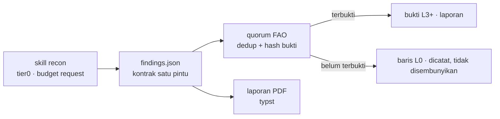

<div align="center">

# cyphron

**Bukti, bukan klaim.**

Mesin security assessment yang berangkat dari bukti. Skill deteksi
ditulis di Python, core-nya native Rust, dan keduanya tunduk pada satu
kontrak output yang ketat.

*No exploit, no report.*

[](https://github.com/maulanawirawan/cyphron/actions/workflows/ci.yml)
[](#development)
[](https://github.com/maulanawirawan/cyphron/releases)
[](#isinya-apa-saja)
[](#mulai-cepat)
[](#mulai-cepat)
[](LICENSE)

[English](README.md) · **Bahasa Indonesia** · [中文](README.zh.md) · [Español](README.es.md)

</div>

---

## Kenapa cyphron dibuat

Kebanyakan scanner ngasih ratusan temuan "mungkin", terus sisanya
urusan kamu. Begitu laporannya dikirim, tim triage nolak dengan alasan
*"impact belum terbukti"*. Dan jujur saja, mereka benar.

cyphron sengaja ambil jalan sebaliknya. **Temuan yang belum bisa
dibuktikan itu masih lead, belum klaim.** Setiap hasil punya posisi di
tangga bukti yang jelas. Kalau ada tool yang outputnya cacat, run-nya
berhenti, bukan diam-diam lanjut. Dan sebuah lead baru naik kelas kalau
sumber-sumber yang independen sepakat.

Hasilnya laporan yang lebih pendek, tapi bisa kamu pertanggungjawabkan.

## Tangga bukti

| Level | Arti | Masuk laporan? |
|---|---|---|
| `L-x` | REJECTED: terbukti false positive | tidak |
| `L0` | OBSERVED: sudah dicek, tidak ada temuan | tidak |
| `L1` | SUSPECTED: lead dari inventaris atau postur | tidak |
| `L2` | REPRODUCED: lead-nya bisa direproduksi | tidak |
| `L3` | DETERMINISTICALLY VERIFIED: ada PoC yang jalan | ✅ |
| `L4` | IMPACT VERIFIED: berhasil mengakses objek milik orang lain | ✅ |
| `L5` | BLIND VALIDATED: dikonfirmasi pihak ketiga | ✅ |

Cuma `L3` ke atas yang bisa masuk laporan. Di bawah itu sifatnya
catatan kerja: apa yang sudah dicek, dan apa hasilnya.



## Isinya apa saja

- **92 skill deteksi** di `skills/` untuk recon, postur, dan exposure.
  Masing-masing CLI mandiri dengan kelas keamanan yang dideklarasikan
  (dari `read-only` sampai `state-changing`) dan batas request yang
  mengikuti kelas itu. Registry-nya berupa allowlist, jadi yang tidak
  terdaftar tidak akan jalan.
- **Core native Rust** di `core-rs/`: `cyphron validate` untuk cek
  kontrak, `cyphron scan` untuk scan bertingkat, sekaligus render
  laporan PDF. Core ini juga menangani korelasi FAO (dedup, quorum, hash
  bukti) dan budget request yang fail-closed.
- **Satu kontrak, dua bahasa.** `findings.json` diimplementasikan di
  Python dan Rust, lalu keduanya diuji silang.
- **Intel yang update sendiri** dari CISA KEV, NVD, dan OSV, supaya
  pencocokan CVE tidak basi.
- **Code map.** Arahkan ke sebuah codebase, hasilnya
  `attack-surface.json` (route, flag auth, handler upload) tanpa satu
  request pun dan tanpa menjalankan kode. Lead lalu dipetakan balik ke
  `file:line`.
- **Night run.** Scan terjadwal dengan deteksi perubahan: lead baru,
  bukti yang melemah, dan verdict yang berubah dicatat per program.
- **MCP server**, jadi cyphron bisa dikendalikan dari Claude Code,
  Cursor, atau MCP client lain.
- **Tier pembuktian yang dikunci** (`tools/exploit_*`) untuk menaikkan
  lead `L1`/`L2` jadi `L3`/`L4` dengan PoC yang bisa direproduksi.
  Defaultnya mati, kecuali target ditandai `exploit_allowed` secara
  eksplisit. Tujuannya untuk lab dan staging. Beberapa teknik (DoS,
  persistence, worm, simulasi ransomware, exfiltration massal) selalu
  ditolak, flag apa pun yang dipakai. Detailnya di
  [docs/EXPLOIT-TIER.md](docs/EXPLOIT-TIER.md).

Pakai AI coding agent? Arahkan ke [AGENTS.md](AGENTS.md). Di sana ada
cara build, test, dan menambah skill.

## Mulai cepat

```bash
# build core native
cargo build --release --manifest-path core-rs/Cargo.toml

# jalankan satu skill
python skills/banner_posture.py --url https://example.com --out banner.json

# cek output terhadap kontrak
core-rs/target/release/cyphron validate banner.json

# scan tier0 lengkap (data publik saja, budget ketat) plus laporan PDF
core-rs/target/release/cyphron scan --domain example.com \
    --max-requests 32 --out findings/scan --report
```

Butuh target latihan yang aman? `python tools/lab_target.py` akan
menyalakan target lab lokal. Catatan instalasi lain ada di
[docs/INSTALL.md](docs/INSTALL.md).

### Code map

```bash
# petakan source sebuah repo jadi attack surface (tanpa request)
python tools/code_map.py --repo <path> --out surface.json --reconcile f.json
```

## Aturan desain

Bagian yang membosankan, tapi justru paling penting.

- **Kontrak satu pintu.** Semua tool menulis bentuk `findings.json`
  yang sama. Output cacat menggagalkan run.
- **Kelas keamanan dan allowlist.** tier0 cuma menjalankan kelas yang
  aman. Skill yang tidak ada di registry tidak akan jalan.
- **Baterai regresi false positive.** FP1 sampai FP16 plus guard per
  kelas ada di test suite. Kalau endpoint kontrol ikut "gagal" dengan
  cara yang sama, klaimnya dibatalkan, bukan dikonfirmasi.
- **Egress yang jujur.** Secara default cyphron memperkenalkan dirinya
  apa adanya. Kamu bisa set `--ua` atau `--proxy` (kredensial
  diredaksi), tapi tidak ada fitur evasion. Itu disengaja.
- **Run manifest.** Setiap artefak dalam satu run dapat sha256, jadi
  rantai bukti tetap bisa dicek berbulan-bulan kemudian.

## Struktur repo

```
core/findings.py   kontrak, sisi Python
core-rs/           core native: kontrak, orchestrator, FAO, serve
skills/            92 skill deteksi + registry.json (allowlist)
tools/             planner, code map, night run, sinkron intel,
                   laporan PDF, MCP server, tier pembuktian, target lab
tests/             suite Python, termasuk regresi FP dan guard test
lab/               situs lab sintetis lokal
docs/              instalasi, egress, night run, intel, kebijakan tier
Dockerfile         image ramping
```

## MCP server

```bash
pip install "mcp[cli]"
```

```json
{
  "mcpServers": {
    "cyphron": {
      "command": "python",
      "args": ["tools/mcp_server.py"]
    }
  }
}
```

Yang diekspos: `cyphron_list_skills` dan `cyphron_run_skill`. Kelas
khusus lab tidak pernah diekspos, dan setiap hasil divalidasi terhadap
kontrak sebelum dikembalikan.

## FAQ

**Ini vulnerability scanner?**
Sebagian. tier0 adalah mesin recon dan postur dengan budget, dan itu
bagian yang paling banyak dipakai. Bagian yang lebih menarik justru
setelahnya: memilah mana yang benar-benar terbukti dan mana yang masih
tebakan.

**Kenapa output-nya banyak baris "belum terbukti"?**
Memang disengaja. Pengecekan yang tidak membuktikan apa-apa tetap
dicatat sebagai baris `L0`, bukan menghilang. False positive biasanya
lahir dari skip yang diam-diam.

**Boleh tier pembuktian dipakai ke production?**
Tolong jangan. Tool ini membuatnya jadi keputusan yang disadari: kamu
harus set `exploit_allowed` per target, dan apa pun yang destruktif
butuh tiga kunci terpisah plus konfirmasi snapshot.

## Development

```bash
python -m pytest tests/ -q
cargo test --release --manifest-path core-rs/Cargo.toml
```

Guard test menjaga Python dan Rust tetap sejalan: tag verdict, ID
temuan, bentuk return `(rows, meta)`, jumlah argumen pemanggil, tidak
ada user agent yang di-hardcode, dan seluruh baterai regresi FP.

## Pemakaian yang bertanggung jawab

cyphron hanya untuk pengujian **yang berizin**: sistem milikmu sendiri,
atau program yang jelas-jelas memberi izin. Memindai sistem orang lain
tanpa izin itu melanggar hukum di hampir semua negara, termasuk
Indonesia (UU ITE). Jangan.

## Kontribusi

PR selalu diterima: perbaikan bug, skill deteksi baru, dokumentasi,
typo. Mulai dari [CONTRIBUTING.md](CONTRIBUTING.md). PR yang di-merge
otomatis masuk daftar contributor.

Kalau cyphron menghemat waktumu, kasih ⭐ supaya orang lain juga bisa
menemukannya.

## Lisensi

[PolyForm Noncommercial 1.0.0](LICENSE). Bebas dipakai, dipelajari,
dimodifikasi, dan dibagikan untuk keperluan **non-komersial**.

Mau dipakai secara komersial, misalnya di dalam layanan berbayar? Boleh
juga, tanya dulu saja nanti kita atur lisensinya. Buka
[issue](https://github.com/maulanawirawan/cyphron/issues) atau hubungi
[@maulanawirawan](https://github.com/maulanawirawan).

Komponen dan sumber data pihak ketiga dicantumkan di
[THIRD-PARTY-NOTICES.md](THIRD-PARTY-NOTICES.md).
