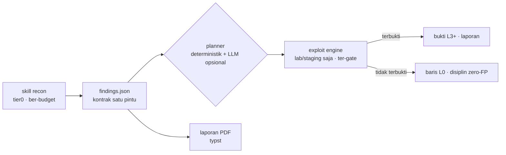

<div align="center">

# cyphron

**Bukti, bukan klaim.** Mesin security-assessment berbasis bukti —
skill Python yang dikendalikan inti Rust native, satu kontrak ketat,
nol false-positive by design.

*No exploit, no report.*

[](#development)
[](https://github.com/maulanawirawan/cyphron/actions/workflows/ci.yml)
[](LICENSE)
[](#quick-start)
[](#quick-start)
[](#isinya-apa-saja)

[English](README.md) · **Bahasa Indonesia** · [中文](README.zh.md) · [Español](README.es.md)

</div>

---

## Kenapa cyphron ada

Kebanyakan scanner nyerahin tembok temuan yang belum terverifikasi terus
bilang "semoga beruntung". Tim triage menolak laporan begitu —
*"demonstrated impact is not clear"* — dan jujur saja, mereka benar.

cyphron mengoptimalkan kebalikannya: **temuan yang tidak bisa dibuktikan
adalah lead, bukan klaim.** Setiap baris membawa verdict di tangga bukti
yang eksplisit, output cacat menghentikan run (bukan lolos diam-diam),
dan korelasi lintas-tool hanya menaikkan kelas bila sumber independen
sepakat.

## Tangga bukti

| Level | Arti | Reportable? |
|---|---|---|
| `L-x` | DITOLAK (terbukti false positive) | — |
| `L0` | OBSERVED — dicek, tidak ada temuan | tidak |
| `L1` | SUSPECTED — lead inventaris/postur | tidak |
| `L2` | REPRODUCED — lead reproduktif | tidak |
| `L3` | DETERMINISTICALLY VERIFIED — PoC | ✅ |
| `L4` | IMPACT VERIFIED — objek milik orang lain terbaca | ✅ |
| `L5` | BLIND VALIDATED — dikonfirmasi pihak ketiga | ✅ |

Hanya `L3+` yang pernah masuk laporan. Sisanya adalah disiplin internal:
apa yang sudah dicek, dan apa buktinya.



## Isinya apa saja

- **75 skill registry** (recon, postur, exposure) — masing-masing
  bawa kelas safety eksplisit (`read-only` → `state-changing`) dan
  budget request keras yang diturunkan darinya.
- **38 playbook exploit** — IDOR, SQLi (boolean/error/time), SSRF +
  chain, XXE (OOB + file in-band), deserialization, JNDI, prototype
  pollution, cache deception **dan poisoning**, JWT (secret lemah +
  alg confusion), CRLF, enumerasi user (reset + registrasi), session
  fixation + sesi yang tak mati setelah logout, lockout, OAuth state,
  host-header poisoning, RCE marker, IDOR massal, regresi auth antar
  versi API… Setiap playbook bawa **kontrol safe-endpoint** — kalau
  kontrolnya ikut "gagal", klaimnya dibuang.
- **Sandbox Docker** — engine jalan di kontainer ephemeral yang
  di-hardening (rootfs read-only, cap-drop ALL, network internal,
  tanpa internet). **38 playbook terbukti end-to-end dari dalam
  kontainer itu**: 140 request, nol trafik eksternal.
- **Attack planner** — inti deterministik secara default (nol request,
  nol eksekusi); LLM lokal opsional hanya boleh *memilih dan
  mengurutkan* dari menu playbook terdaftar, outputnya divalidasi
  keras. Selalu meng-emit `exploit_allowed: false`.
- **Code map** — parse source code repo target jadi
  `attack-surface.json` (routes, flag auth, upload handler) dengan
  nol request dan nol eksekusi kode, lalu memetakan lead ke
  `file:line`.
- **Night run** — scan terjadwal dengan drift detection: lead baru,
  bukti yang melemah, dan perubahan verdict terlacak per program.
- **Satu kontrak, dua bahasa** — `findings.json` diimplementasi identik
  di Python dan Rust dan diuji silang; inti native juga bawa korelasi
  FAO (dedup, quorum, hash bukti) dan budget request yang fail-closed.

## Quick start

```bash
# bangun inti native
cargo build --release --manifest-path core-rs/Cargo.toml

# jalankan satu skill langsung
python skills/banner_posture.py --url https://example.com --out banner.json

# validasi terhadap kontrak
core-rs/target/release/cyphron validate banner.json

# scan tier0 penuh (hanya data publik, budget ketat) + laporan PDF
core-rs/target/release/cyphron scan --domain example.com \
    --max-requests 32 --out findings/scan --report
```

### Exploit tier (lab saja — bagian yang di-gate)

```bash
# lab target rentan lokal
python tools/lab_target.py &

# jalankan playbook — wajib exploit_allowed: true di config
python tools/exploit_engine.py --config exploit-lab.json --out findings/exploit

# atau semuanya di dalam sandbox ephemeral yang di-hardening
python tools/exploit_sandbox.py --config exploit-lab.json \
    --out findings/exploit-sandbox --lab-in-docker
```

Engine menolak menembakkan satu request pun ke target tanpa
`exploit_allowed: true` eksplisit. Mode destructive butuh tiga kunci
sekaligus, dan never-list (DoS, persistence, worm, ransomware) tidak
bisa dibuka oleh flag apa pun.

### Planner & code map

```bash
# ubah lead jadi attack plan — selalu emit exploit_allowed: false
python tools/attack_planner.py --findings f.json --out plan.json

# petakan source repo jadi attack surface (nol request)
python tools/code_map.py --repo <path> --out surface.json --reconcile f.json
```

## Aturan desain (bagian membosankan yang penting)

- **Kontrak satu pintu** — semua tool menulis shape `findings.json`
  yang sama; output cacat = run gagal (fail-closed).
- **Kelas safety + registry allowlist** — tier0 hanya menjalankan kelas
  yang lembut; registry itu allowlist, bukan blacklist.
- **Baterai regresi zero-FP** — FP1–FP16 plus guard per kelas bagian
  dari suite; endpoint kontrol yang "ikut gagal" membatalkan klaim,
  bukan mengonfirmasinya.
- **Egress low-profile** — identitas tool jujur secara default; `--ua`/
  `--proxy` opsional dengan kredensial ter-redaksi. Tanpa fitur evasion,
  sengaja.
- **Run manifest** — sha256 semua artefak per run, supaya rantai bukti
  tetap bisa diverifikasi belakangan.

## Struktur repo

```
core/findings.py        # kontrak satu pintu (sisi Python)
core-rs/                # inti native: contract, orchestrator, FAO, serve
skills/                 # 75 skill registry + registry.json (allowlist)
tools/                  # exploit engine/playbook/sandbox, planner,
                        # code-map, nightrun, laporan PDF, MCP server…
tests/                  # suite Python (termasuk regresi FP + guard)
lab/                    # situs lab lokal sintetis
docs/                   # kebijakan exploit tier, egress, install, nightrun
Dockerfile              # image produk slim
```

## MCP server (Claude Code / Cursor / klien MCP lain)

```bash
pip install "mcp[cli]"
```

```json
{
  "mcpServers": {
    "cyphron": {
      "command": "python",
      "args": ["tools/mcp_server.py"]
    }
  }
}
```

Ekspos `cyphron_list_skills` dan `cyphron_run_skill` — kelas lab-only
tidak pernah terekspos, dan setiap hasil divalidasi kontrak sebelum
dikembalikan.

## FAQ

**Ini vulnerability scanner?**
Sebagian. Sisi tier0 adalah engine recon/postur ber-budget. Sisi yang
lebih menarik adalah exploit tier: mengubah "mungkin" jadi "terbukti"
dengan PoC reproduktif — di target yang berhak kamu uji.

**Kenapa outputnya banyak banget baris "not proven"?**
Justru itu poinnya. Bukti yang gagal dicatat sebagai baris L0, bukan
disembunyikan. Skip senyap adalah tempat false positive lahir.

**Boleh arahkan exploit engine ke situs produksi?**
Jangan — dan tool-nya membuat itu jadi tindakan sadar dan eksplisit
(`exploit_allowed` per target, dirancang untuk lab/staging). Untuk yang
destructive kamu butuh tiga kunci independen plus snapshot.

## Development

```bash
python -m unittest discover -s tests
cargo test --release --manifest-path core-rs/Cargo.toml
```

Guard test menjaga kontrak lintas bahasa: verdict tag, finding id, bentuk
return `(rows, meta)`, arity pemanggil, anti-UA-hardcoding, dan baterai
regresi FP.

## Ruang lingkup & penggunaan bertanggung jawab

cyphron untuk security assessment yang **berotorisasi**: aset milikmu
sendiri, atau program yang secara eksplisit memberi izin. Memindai sistem
yang bukan milikmu tanpa otorisasi itu ilegal di hampir semua yurisdiksi —
jangan.

## Lisensi

[PolyForm Noncommercial 1.0.0](LICENSE) - free to use, study, modify, and
share for **noncommercial purposes**.

Selling Cyphron, or using it commercially (including offering it as a paid
service), requires a separate commercial license - contact the owner via
[GitHub issues](https://github.com/maulanawirawan/cyphron/issues) or
[@maulanawirawan](https://github.com/maulanawirawan).

Bundled third-party components and data sources are credited in
[THIRD-PARTY-NOTICES.md](THIRD-PARTY-NOTICES.md).
