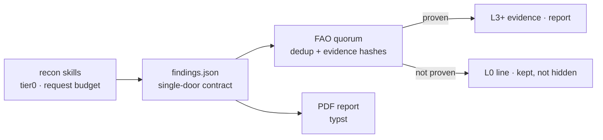

<div align="center">

# secai

**Proof, not claims.**

**secai** is an evidence-first **agentic cybersecurity** engine with
**271 capability scripts** — 93 registered detection skills + 175
offline tools (120 ported from 995 skill concepts), a native Rust
core, one strict findings contract, and an MCP server — so Claude
Code, Cursor, or any shell-capable agent can drive it.

*No proof, no report.*

[](https://github.com/maulanawirawan/secai/actions/workflows/ci.yml)
[](#whats-inside)
[](https://github.com/maulanawirawan/secai/releases)
[](#whats-inside)
[](#quick-start)
[](#quick-start)
[](LICENSE.md)

**English** · [中文](README.zh.md) · [Español](README.es.md)

</div>

---

## Use it from your agent

secai ships as a one-command CLI with modes, a loadable agent skill,
and an MCP server — so Claude Code, Cursor, or any agent that
runs shell commands can drive it directly.

```bash
git clone https://github.com/maulanawirawan/secai && cd secai
python secai.py                          # mode board
python secai.py <mode> --help            # every option of one mode
claude mcp add secai -- python tools/mcp_server.py   # MCP (tier0 allowlist)
```

Agents: load [SKILL.md](SKILL.md) — the manual that teaches an agent to
drive secai safely. Authorized targets only; no proof, no report.

## Why this exists

Most scanners hand you a few hundred "possible" findings and leave the
rest to you. Then a triage team bounces the report with *"impact not
demonstrated"*, and, honestly, they're right to.

secai goes the other way. **A finding you can't prove is a lead, not
a claim.** Every result sits on an explicit evidence ladder. If a tool
produces malformed output, the run stops instead of quietly moving on.
And a lead only gets promoted when independent sources agree on it.

The result is a shorter report you can actually defend.

## Use it for

secai is a public, open project built for real security work. Typical uses:

- **Bug bounty & VDP work** — enumerate the attack surface (headers, CORS,
  GraphQL, API docs, exposure, cookie scope) and get verdicts that survive
  triage instead of a wall of "possible issues".
- **Pentesting your own coding projects** — point the skills at your
  staging/local build before shipping and catch the low-hanging fruit:
  missing headers, debug pages, leaked files, unauth'd endpoints, permissive
  CORS, outdated exposure.
- **Building security into your pipeline** — the findings.json contract and
  `secai validate` make outputs CI-friendly; the Rust core speaks the same
  contract, so gates can be wired straight into a build.
- **Learning the craft** — the bundled lab target plus
  `docs/AWARENESS-PATTERNS.md` (nine real-world vulnerability patterns traced
  end-to-end from official diffs) make it a hands-on classroom.

Stay on the rails: authorized targets only, and the strict gates on the
proof tier are part of the design, not an obstacle.

## See it think

Point a skill at the bundled lab target and watch the verdicts, not just
a pile of "findings." This is real output, copied verbatim (the tools
print in Indonesian — `temuan` = findings, `AMAN` = clear, `request` =
requests):

```console
$ python tools/lab_target.py
lab target aktif: http://127.0.0.1:8777

$ python skills/http_security_headers.py \
    --url http://127.0.0.1:8777/api/products --from-raw raw.txt \
    --out headers.json
http-security-headers: 8 temuan (2 AMAN) (0 request) -> headers.json

$ secai validate headers.json
OK: 8 findings valid terhadap kontrak (headers.json)
```

Now look at what's actually in `headers.json` — every row carries its
own verdict:

```
L1 SUSPECTED   low    Security header absent: Content-Security-Policy    reportable: false
L1 SUSPECTED   low    Security header absent: X-Frame-Options            reportable: false
L1 SUSPECTED   low    Security header absent: X-Content-Type-Options     reportable: false
L1 SUSPECTED   info   Security header absent: Referrer-Policy            reportable: false
L1 SUSPECTED   info   Security header absent: Permissions-Policy         reportable: false
L0 OBSERVED    info   No version leak via Server                         reportable: false
L0 OBSERVED    info   No version leak via X-Powered-By                   reportable: false
L1 SUSPECTED   low    Security headers posture: 0/5 present              reportable: false
```

Notice what *didn't* happen: nothing got called a vulnerability. These
are `L1` leads and `L0` ("checked, found nothing") lines, every one
marked `reportable: false`, because none of them is proven. That's the
whole point.

## The evidence ladder

| Level | Meaning | Goes in the report? |
|---|---|---|
| `L-x` | REJECTED: proven false positive | no |
| `L0` | OBSERVED: checked, nothing found | no |
| `L1` | SUSPECTED: inventory or posture lead | no |
| `L2` | REPRODUCED: the lead reproduces | no |
| `L3` | DETERMINISTICALLY VERIFIED: working PoC | ✅ |
| `L4` | IMPACT VERIFIED: accessed an object that isn't yours | ✅ |
| `L5` | BLIND VALIDATED: confirmed by a third party | ✅ |

Only `L3` and above ever reach a report. Everything below that is
bookkeeping: what you checked, and what it showed.



## What's inside

- **93 detection skills** in `skills/` covering recon, posture, and
  exposure. Each one is a standalone CLI with a declared safety class
  (`read-only` up to `state-changing`) and a hard request budget that
  follows from it. The registry is an allowlist, so nothing runs unless
  it's listed.
- **A native Rust core** in `core-rs/`: `secai validate` checks the
  contract, `secai scan` runs tiered scans, and it renders the PDF
  report. It also handles FAO correlation (dedup, quorum, evidence
  hashes) and a request budget that fails closed.
- **One contract, two languages.** `findings.json` is implemented in
  both Python and Rust, and the two are cross-tested against each other.
- **Self-updating intel** from CISA KEV, NVD, and OSV, so CVE matching
  doesn't go stale.
- **Code map.** Point it at a codebase and it produces an
  `attack-surface.json` (routes, auth flags, upload handlers) with zero
  requests and zero code execution, then ties leads back to `file:line`.
- **Night runs.** Scheduled scans with drift detection: new leads,
  weakened evidence, and changed verdicts are tracked per program.
- **MCP server** so you can drive secai from Claude Code, Cursor, or
  any other MCP client.
- **A gated proof tier** (`tools/exploit_*`) for turning `L1`/`L2` leads
  into `L3`/`L4` with reproducible PoCs. It's off unless a target is
  explicitly marked `exploit_allowed`, it's meant for labs and staging,
  and some techniques (DoS, persistence, worms, ransomware simulation,
  mass exfiltration) are refused no matter what flags you pass. Details
  in [docs/EXPLOIT-TIER.md](docs/EXPLOIT-TIER.md).

Using an AI coding agent? Point it at [AGENTS.md](AGENTS.md). It covers
how to build, test, and add a skill.

## Capability map

The triage family is a set of standalone offline CLI tools: evidence in
(logs, exports, manifests, binaries), deterministic findings.json out,
fail-closed, zero network. Highlights by domain:

<details>
<summary><b>120 ported tools across 9 domains (175 total in tools/) — click to expand</b></summary>
<br>

| Domain | Answers the question… | Examples |
|:---|:---|:---|
| Windows event triage | "who moved laterally / persisted / dumped creds?" | `sysmon_triage`, `win_persist_triage`, `dcsync_triage`, `ps_scriptlog_triage` |
| Linux & host hardening | "is this host hardened / backdoored / privesc-able?" | `linux_cis_audit`, `linux_persist_scan`, `linux_privesc_audit`, `aide_change_triage` |
| Cloud & container config | "is this bucket / role / pod / function exposed?" | `aws_config_audit`, `gcp_fw_audit`, `k8s_podsec_audit`, `netpol_audit`, `lambda_config_audit` |
| Web, API & OAuth | "is this spec/flow/redirect/token abusable?" | `openapi_spec_audit`, `graphql_depth_audit`, `oauth_redirect_audit`, `jwt_token_audit` |
| Malware & binary | "what can this binary/doc do, and what does it embed?" | `pe_import_scan`, `rust_binary_triage`, `crypto_constant_scan`, `stego_triage`, `sqlite_forensics` |
| Secrets & data | "what leaked, where, and how bad?" | `paste_triage`, `secret_report_ingest`, `data_class_scan`, `browser_history_triage` |
| Supply chain & CI/CD | "can this pipeline/provenance be trusted?" | `gha_workflow_audit`, `slsa_provenance_audit`, `pkg_typosquat_check`, `sarif_ingest` |
| Vuln management | "what do we fix first, and why?" | `ssvc_triage`, `owasp_risk_rating`, `attack_coverage`, `kev_gap` |
| Validation & reporting | "is this finding real, and how do we say it?" | `verify_gate`, `brocards_triage`, `log_chain_verify`, `report_pack` |

</details>

The full index lives in [CHANGELOG.md](CHANGELOG.md); the methodology
distilled from non-tool-shaped concepts (250 sections) lives in
[docs/PORT-AGENT-METHODS.md](docs/PORT-AGENT-METHODS.md).

## Commands

| Command | What it does |
|:---|:---|
| `secai scan --domain example.com --max-requests 32 --report` | Full tier0 scan (public data only, strict budget) + PDF report |
| `secai validate findings.json` | Check any findings.json against the contract (Rust core) |
| `secai merge --dedup-id ...` | Merge + dedup finding sets (FAO correlation) |
| `python skills/<skill>.py --url … --out f.json` | Run a single detection skill (93 available, allowlist-gated) |
| `python tools/code_map.py --repo <path> --out surface.json` | Map a codebase to an attack surface — zero requests |
| `python tools/chain_planner.py --findings f.json` | Plan A→B→C exploit chains from existing findings |
| `python tools/submission_gate.py --finding f.json --program p.json` | 7-question pre-submission gate for a finding |
| `claude mcp add secai -- python tools/mcp_server.py` | Drive secai from Claude Code / any MCP client |
| `python tools/lab_target.py` | Start a local lab target to practice on |

Night runs (scheduled scans with drift detection) and intel sync
(CISA KEV / NVD / OSV) are documented in [docs/](docs/).

## Quick start

```bash
# build the native core
cargo build --release --manifest-path core-rs/Cargo.toml

# run a single skill
python skills/banner_posture.py --url https://example.com --out banner.json

# check the output against the contract
core-rs/target/release/secai validate banner.json

# full tier0 scan (public data only, strict budget) plus a PDF report
core-rs/target/release/secai scan --domain example.com \
    --max-requests 32 --out findings/scan --report
```

Want something safe to practice on? `python tools/lab_target.py` starts
a local lab target. More setup notes are in
[docs/INSTALL.md](docs/INSTALL.md).

### Code map

```bash
# map a repo's source to an attack surface (no requests sent)
python tools/code_map.py --repo <path> --out surface.json --reconcile f.json
```

## Design rules

The boring part, which is also the important part.

- **Single-door contract.** Every tool writes the same `findings.json`
  shape. Malformed output fails the run.
- **Safety classes and an allowlist.** tier0 only runs the gentle
  classes. If a skill isn't in the registry, it doesn't run.
- **False-positive regression battery.** FP1 to FP16 plus per-class
  guards live in the test suite. If a control endpoint "fails" the same
  way, the claim is cancelled, not confirmed.
- **Honest egress.** secai identifies itself by default. You can set
  `--ua` or `--proxy` (credentials get redacted), but there are no
  evasion features, on purpose.
- **Run manifest.** Every artifact in a run gets a sha256, so the
  evidence chain can still be checked months later.

## Repo layout

```
core/findings.py   the contract, Python side
core-rs/           native core: contract, orchestrator, FAO, serve
skills/            93 detection skills + registry.json (the allowlist)
tools/             planner, code map, night runs, intel sync,
                   PDF report, MCP server, gated proof tier, lab target
tests/             Python suite, incl. FP regression and guard tests
lab/               synthetic local lab site
docs/              install, egress, night runs, intel, proof tier policy
Dockerfile         slim image
```

## MCP server

```bash
pip install "mcp[cli]"
```

```json
{
  "mcpServers": {
    "secai": {
      "command": "python",
      "args": ["tools/mcp_server.py"]
    }
  }
}
```

This exposes `secai_list_skills` and `secai_run_skill`. Lab-only
classes are never exposed, and every result is validated against the
contract before it comes back to you.

## FAQ

**Is this a vulnerability scanner?**
Partly. tier0 is a budgeted recon and posture engine, which is the part
most people will use. The more interesting part is what happens after:
deciding what's actually proven and what's still a guess.

**Why is the output full of "not proven" lines?**
That's on purpose. A check that didn't prove anything gets recorded as
an `L0` line instead of disappearing. Silent skips are where false
positives come from.

**Can I run the proof tier against production?**
Please don't. The tool makes it a deliberate act: you have to set
`exploit_allowed` per target, and anything destructive needs three
separate keys plus a snapshot acknowledgement.

## Development

```bash
python -m pytest tests/ -q
cargo test --release --manifest-path core-rs/Cargo.toml
```

Guard tests keep the two languages honest with each other: verdict
tags, finding IDs, `(rows, meta)` return shapes, caller arity, no
hardcoded user agents, and the full FP regression battery.

## Responsible use

secai is for **authorized** testing only: your own systems, or
programs that clearly give you permission. Scanning things you don't
own without permission is illegal in most places. Don't.

## Community

- 🐛 **Found a bug?** → [bug report](.github/ISSUE_TEMPLATE/bug_report.md)
- 🙅 **A detector flagged something benign?** → [false positive report](.github/ISSUE_TEMPLATE/false_positive.md) — FP reports are first-class here; every one tightens an anti-FP floor
- 💡 **Missing a capability?** → [feature request](.github/ISSUE_TEMPLATE/feature_request.md)
- 🔒 **Security issue in secai itself?** → [SECURITY.md](.github/SECURITY.md) (private disclosure, no public issue)
- 🤝 [Contributing guide](CONTRIBUTING.md) · [Code of Conduct](.github/CODE_OF_CONDUCT.md) · [Changelog](CHANGELOG.md)

## Contributing

PRs are welcome: bug fixes, new detection skills, docs, typos. Start
with [CONTRIBUTING.md](CONTRIBUTING.md). Merged PRs land you in the
contributors list.

If secai saves you some time, a ⭐ helps other people find it.

## Star History

[](https://star-history.com/#maulanawirawan/secai&Date)

## Credits

- [Agentic-Bug-Hunter](https://github.com/awarexone/Agentic-Bug-Hunter)
  (MIT) — concept source for the scope/chain/web3/memory/report
  mini-program (`scope_gate`, `chain_planner`, `solidity_static_audit`,
  `hunt_pattern_db`, and friends).
- The 995-concept skill-port program drew on four public security-skill
  collections (trailofbits/skills, SnailSploit/Claude-Red,
  mukul975/Anthropic-Cybersecurity-Skills, NVIDIA-SkillSpector) — every
  ported tool is built from scratch with concept attribution in its
  docstring.

## Roadmap

- [ ] **Deeper Web3 audits** — AST-level Solidity analysis beyond the
      current static-lead layer (`solidity_static_audit`)
- [ ] **Auto-fix suggestions** — remediation hints attached to each
      finding class, not just the detection
- [x] **One-command install** — `install.sh` builds + links the
      `secai` binary (no manual cargo dance)
- [ ] **Web dashboard** — browse findings, evidence, and drift across
      programs without reading JSON
- [ ] **More platform report formats** — YesWeHack, Synack on top of
      the current HackerOne / Bugcrowd / Intigriti drafts

## License

[PolyForm Noncommercial 1.0.0](LICENSE.md). Free to use, study, modify, and
share for **noncommercial** purposes.

Want to use it commercially, for example inside a paid service? That's
fine too, just ask first and we'll work out a license. Open an
[issue](https://github.com/maulanawirawan/secai/issues) or reach me at
[@maulanawirawan](https://github.com/maulanawirawan).

Third-party components and data sources are credited in
[THIRD-PARTY-NOTICES.md](THIRD-PARTY-NOTICES.md).
