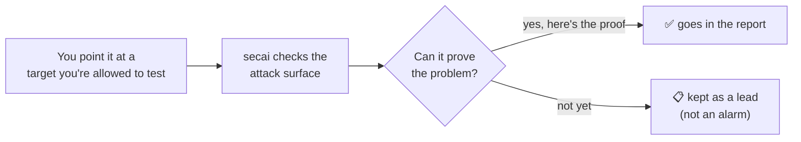

<div align="center">

# secai

**Proof, not claims.**

*A security scanner that refuses to report anything it can't prove.*

[](https://github.com/maulanawirawan/secai/actions/workflows/ci.yml)
[](https://github.com/maulanawirawan/secai/releases)
[](#whats-inside)
[](#whats-inside)
[](https://github.com/maulanawirawan/secai/actions/workflows/ci.yml)
[](#quick-start-try-it-in-60-seconds)
[](#quick-start-try-it-in-60-seconds)
[](LICENSE.md)

**English** · [中文](README.zh.md) · [Español](README.es.md)

</div>

<!--
  ⭐ Maintainer note: the single biggest thing you can add here is a short
  demo GIF (10–20s) of `python tools/lab_target.py` + one skill run, placed
  right below. Record with asciinema + agg, or ScreenToGif, save to
  assets/demo.gif, then uncomment:
  
-->

---

## What is this? (plain English)

Most security scanners dump a few hundred *"this might be a problem"*
lines on you and walk away. You're left to figure out which ones are
real. secai does the opposite: it only tells you about a problem when it
can **show you the proof**. Everything else is filed as a lead, not
sounded as an alarm.

Think of a normal scanner as a smoke detector that shrieks every time you
make toast. **secai only reports a fire it can actually point to.**

You don't need to be a security expert to use it. If you can copy-paste a
command, you can run the built-in practice target and watch it work in
under a minute (see [Quick start](#quick-start-try-it-in-60-seconds)). The
deep security machinery is all there when you want it — it just stays out
of your way until then.



> **secai** = **sec**urity + **a**gentic **i**ntelligence. It's an
> evidence-first cybersecurity engine: **95 detection skills** and
> **200 offline triage tools** (298 scripts in all), a native Rust core,
> one strict "findings" format, and an MCP server — so Claude Code,
> Cursor, or any shell-capable AI agent can drive it for you.

---

## Quick start — try it in 60 seconds

No target of your own? No problem. secai ships with a **local practice
site** so you can see it work safely, right now:

```bash
git clone https://github.com/maulanawirawan/secai && cd secai

# 1. start the local practice target (safe, runs on your own machine)
python tools/lab_target.py

# 2. in another terminal, run one detection skill against it
python skills/http_security_headers.py \
    --url http://127.0.0.1:8777/api/products --out headers.json

# 3. see the result — every line carries its own verdict
python secai.py validate headers.json
```

That's it. No API keys, no account, no cloud. Want the full scan engine
and PDF reports? Build the native core (one command) — see
[Quick start: the full engine](#quick-start-the-full-engine) below.

> **Heads up on language:** the tools currently print their status in
> Indonesian — `temuan` = findings, `AMAN` = clear/safe, `request` =
> requests. An English-output mode is on the [roadmap](#roadmap). Until
> then, this glossary is all you need to read the output.

---

## See it think

Point a skill at the practice target and watch the *verdicts*, not just a
pile of "findings." This is real output, copied verbatim:

```console
$ python tools/lab_target.py
lab target aktif: http://127.0.0.1:8777     # "lab target active"

$ python skills/http_security_headers.py \
    --url http://127.0.0.1:8777/api/products --from-raw raw.txt \
    --out headers.json
http-security-headers: 8 temuan (2 AMAN) (0 request) -> headers.json
#                        ^8 findings  ^2 clear  ^0 requests sent

$ secai validate headers.json
OK: 8 findings valid terhadap kontrak (headers.json)   # "valid against the contract"
```

Now look at what's actually inside `headers.json` — every row carries its
own verdict and says whether it's report-worthy:

```
L1 SUSPECTED   low    Security header absent: Content-Security-Policy    reportable: false
L1 SUSPECTED   low    Security header absent: X-Frame-Options            reportable: false
L1 SUSPECTED   low    Security header absent: X-Content-Type-Options     reportable: false
L1 SUSPECTED   info   Security header absent: Referrer-Policy            reportable: false
L1 SUSPECTED   info   Security header absent: Permissions-Policy         reportable: false
L0 OBSERVED    info   No version leak via Server                         reportable: false
L0 OBSERVED    info   No version leak via X-Powered-By                   reportable: false
L1 SUSPECTED   low    Security headers posture: 0/5 present              reportable: false
```

Notice what *didn't* happen: nothing got called a vulnerability. These
are `L1` leads and `L0` ("checked, found nothing") lines, every one marked
`reportable: false`, because none of them is proven yet. **That's the
whole point.**

## The evidence ladder

Every result sits on one explicit ladder. Only the top rungs — where
there's actual proof — ever reach a report.

| Level | Meaning | In the report? |
|---|---|---|
| `L-x` | REJECTED: proven false positive | no |
| `L0` | OBSERVED: checked, nothing found | no |
| `L1` | SUSPECTED: a lead (inventory or posture) | no |
| `L2` | REPRODUCED: the lead reproduces | no |
| `L3` | **DETERMINISTICALLY VERIFIED: working proof-of-concept** | ✅ |
| `L4` | **IMPACT VERIFIED: reached an object that isn't yours** | ✅ |
| `L5` | **BLIND VALIDATED: confirmed by a third party** | ✅ |

Everything below `L3` is bookkeeping: what you checked, and what it
showed. Nothing gets dressed up as more than it is.

## Why this exists

Most scanners hand you a few hundred "possible" findings and leave the
rest to you. Then a triage team bounces the report with *"impact not
demonstrated"* — and, honestly, they're right to.

secai goes the other way. **A finding you can't prove is a lead, not a
claim.** If a tool produces malformed output, the run *stops* instead of
quietly moving on. And a lead only gets promoted when independent sources
agree on it. The result is a shorter report you can actually defend.

## Who it's for

secai is a public, open project built for real security work — and for
people learning it. Typical uses:

- **Bug bounty & VDP hunters** — map the attack surface (headers, CORS,
  GraphQL, API docs, exposure, cookie scope) and get verdicts that survive
  triage instead of a wall of "possible issues."
- **Developers checking their own apps** — point the skills at your
  staging/local build before you ship and catch the easy wins: missing
  headers, debug pages, leaked files, unauthenticated endpoints,
  permissive CORS, stale exposure.
- **Teams building security into CI** — the `findings.json` contract and
  `secai validate` make outputs pipeline-friendly; the Rust core speaks
  the same contract, so you can wire gates straight into a build.
- **People learning the craft** — the bundled practice target plus
  [`docs/AWARENESS-PATTERNS.md`](docs/AWARENESS-PATTERNS.md) (nine
  real-world vulnerability patterns traced end-to-end from official code
  fixes) make it a hands-on classroom.

One rule, no exceptions: **authorized targets only** — your own systems,
or programs that clearly give you permission.

## Use it from your AI agent

secai ships as a one-command CLI, a loadable agent skill, and an MCP
server — so Claude Code, Cursor, or any agent that can run shell commands
can drive it directly.

```bash
python secai.py                          # the mode board (always works, zero deps)
python secai.py <mode> --help            # every option of one mode
claude mcp add secai -- python tools/mcp_server.py   # add as an MCP tool
```

Building an agent integration? Point it at [SKILL.md](SKILL.md) (the
manual that teaches an agent to drive secai safely) and [AGENTS.md](AGENTS.md)
(how to build, test, and add a skill).

## What's inside

- **95 registered detection skills** in `skills/` — recon, posture, and
  exposure checks. Each is a standalone command-line program with a
  declared safety class (from `read-only` up to `state-changing`) and a
  hard request budget. The registry is an *allowlist*: if a skill isn't
  listed, it doesn't run.
- **200 offline triage tools** in `tools/` — evidence in (logs, exports,
  manifests, binaries), deterministic `findings.json` out, zero network.
  121 of them were ported from 995 public skill concepts, each rebuilt
  from scratch with attribution.
- **A native Rust core** in `core-rs/` — `secai validate` checks the
  contract, `secai scan` runs tiered scans and renders the PDF report, and
  it handles cross-tool correlation (dedup, quorum, evidence hashes) with
  a request budget that fails closed.
- **One contract, two languages** — `findings.json` is implemented in both
  Python and Rust, and the two are cross-tested so they can't drift apart.
- **Self-updating CVE intel** from CISA KEV, NVD, and OSV, so matching
  doesn't go stale.
- **Code map** — point it at a codebase and it produces an
  `attack-surface.json` (routes, auth flags, upload handlers) with zero
  requests and zero code execution, then ties leads back to `file:line`.
- **Night runs** — scheduled scans with drift detection: new leads,
  weakened evidence, and changed verdicts, tracked per program.
- **A gated proof tier** (`tools/exploit_*`) for turning `L1`/`L2` leads
  into `L3`/`L4` with reproducible proofs. It's **off** unless a target is
  explicitly marked `exploit_allowed`, it's meant for labs and staging,
  and some techniques (DoS, persistence, worms, ransomware simulation,
  mass exfiltration) are refused no matter what flags you pass. Details in
  [docs/EXPLOIT-TIER.md](docs/EXPLOIT-TIER.md).

*(298 Python scripts in total across `skills/` and `tools/`; 95 of the
skills are registered in the allowlist, the rest are shared helpers.)*

## Capability map

The triage family is a set of standalone offline tools: evidence in,
deterministic `findings.json` out, fail-closed, zero network. Highlights
by domain:

(quoted as *concept* references only; every implementation here is written
from scratch, stdlib-only, and documented with its source entry in the
module docstring).

<details>
<summary><b>121 ported tools + 13 offensive/blue-bridge + 7 intel-DFIR + 4 capture/document-bait tools (200 total in tools/) — click to expand</b></summary>
<br>

| Domain | Answers the question… | Examples |
|:---|:---|:---|
| Windows event triage | "who moved laterally / persisted / dumped creds?" | `sysmon_triage`, `win_persist_triage`, `dcsync_triage`, `ps_scriptlog_triage` |
| Linux & host hardening | "is this host hardened / backdoored / privesc-able?" | `linux_cis_audit`, `linux_persist_scan`, `linux_privesc_audit`, `aide_change_triage` |
| Cloud & container config | "is this bucket / role / pod / function exposed?" | `aws_config_audit`, `gcp_fw_audit`, `k8s_podsec_audit`, `netpol_audit`, `lambda_config_audit` |
| Web, API & OAuth | "is this spec/flow/redirect/token abusable?" | `openapi_spec_audit`, `graphql_depth_audit`, `oauth_redirect_audit`, `jwt_token_audit` |
| Malware & binary | "what can this binary/doc do, and what does it embed?" | `pe_import_scan`, `rust_binary_triage`, `crypto_constant_scan`, `stego_triage`, `sqlite_forensics` |
| Secrets & data | "what leaked, where, and how bad?" | `paste_triage`, `secret_report_ingest`, `data_class_scan`, `browser_history_triage` |
| Supply chain & CI/CD | "can this pipeline/provenance be trusted?" | `gha_workflow_audit`, `slsa_provenance_audit`, `pkg_typosquat_check`, `sarif_ingest` |
| Vuln management | "what do we fix first, and why?" | `ssvc_triage`, `owasp_risk_rating`, `attack_coverage`, `kev_gap` |
| Validation & reporting | "is this finding real, and how do we say it?" | `verify_gate`, `brocards_triage`, `log_chain_verify`, `report_pack` |
| **Offensive proof** (new) | "can I *prove* this is exploitable, safely?" | `jwt_crypto_attack`, `bola_bfla_prover`, `nosql_injection_analyzer`, `ssrf_metadata_map`, `ssti_exploit_plan`, `iam_assume_chain` |
| **Detection bridge** (new) | "turn a finding into a detection" | `detection_rule_gen` (Sigma+YARA), `attack_navigator_export` |
| **Quishing & doc-bait triage** (new) | "is this QR contact / document callback / capture / event log suspicious?" | `qr_vcard_triage`, `doc_beacon_triage`, `capture_triage`, `evtx_hunt` |

</details>

**See a real output shape:** [assets/sample-findings/banner_posture.json](assets/sample-findings/banner_posture.json) — generated by running `banner_posture` against the built-in lab target (`secai lab`), host redacted. One request, four L1 leads (absent security headers) — exactly what `secai validate` then checks against the contract.

The full index lives in [CHANGELOG.md](CHANGELOG.md); the methodology
distilled from non-tool-shaped concepts (250+ sections) lives in

## Commands

| Command | What it does |
|:---|:---|
| `secai scan --domain example.com --max-requests 32 --report` | Full tier0 scan (public data only, strict budget) + PDF report |
| `secai validate findings.json` | Check any `findings.json` against the contract (Rust core) |
| `secai merge --dedup-id ...` | Merge + dedup finding sets (cross-tool correlation) |
| `python skills/<skill>.py --url … --out f.json` | Run one of the 95 registered detection skills (allowlist-gated) |
| `secai run --net-budget 8 --net-scope scope.json --out f.json <skill…>` | Run one skill under net-guard: request budget + scope default-deny + IP-pinned connect (anti-DNS-rebinding) |
| `python tools/code_map.py --repo <path> --out surface.json` | Map a codebase to an attack surface — zero requests |
| `python tools/chain_planner.py --findings f.json` | Plan A→B→C exploit chains from existing findings |
| `python tools/submission_gate.py --finding f.json --program p.json` | 7-question pre-submission gate for a finding |
| `claude mcp add secai -- python tools/mcp_server.py` | Drive secai from Claude Code / any MCP client |
| `python tools/lab_target.py` | Start a local practice target |

## Quick start: the full engine

```bash
# build the native core (one command)
cargo build --release --manifest-path core-rs/Cargo.toml

# run a single skill
python skills/banner_posture.py --url https://example.com --out banner.json

# check the output against the contract
core-rs/target/release/secai validate banner.json

# full tier0 scan (public data only, strict budget) plus a PDF report
core-rs/target/release/secai scan --domain example.com \
    --max-requests 32 --out findings/scan --report
```

Full prerequisites and optional components are in
[docs/INSTALL.md](docs/INSTALL.md). Night runs and intel sync are in
[docs/](docs/).

## Design rules

The boring part, which is also the important part.

- **Single-door contract.** Every tool writes the same `findings.json`
  shape. Malformed output fails the run.
- **Safety classes and an allowlist.** tier0 only runs the gentle
  classes. If a skill isn't in the registry, it doesn't run.
- **False-positive regression battery.** FP1 to FP16 plus per-class
  guards live in the test suite. If a control endpoint "fails" the same
  way the target did, the claim is cancelled, not confirmed.
- **Honest egress.** secai identifies itself by default. You can set
  `--ua` or `--proxy` (credentials get redacted), but there are no
  evasion features, on purpose.
- **Run manifest.** Every artifact in a run gets a sha256, so the evidence
  chain can still be checked months later.

## MCP server

```bash
pip install "mcp[cli]"
```

```json
{
  "mcpServers": {
    "secai": { "command": "python", "args": ["tools/mcp_server.py"] }
  }
}
```

This exposes `secai_list_skills` and `secai_run_skill`. Lab-only classes
are never exposed, and every result is validated against the contract
before it comes back to you.

## FAQ

**Do I need to know security to use this?**
No. Run the practice target ([Quick start](#quick-start-try-it-in-60-seconds))
and you'll see verdicts in plain rows. The glossary above covers the
Indonesian status words. Read [docs/AWARENESS-PATTERNS.md](docs/AWARENESS-PATTERNS.md)
to learn what the findings mean.

**Is this a vulnerability scanner?**
Partly. tier0 is a budgeted recon and posture engine — the part most
people use. The more interesting part is what happens after: deciding
what's actually proven and what's still a guess.

**Why is the output full of "not proven" lines?**
On purpose. A check that didn't prove anything gets recorded as an `L0`
line instead of disappearing. Silent skips are where false positives are
born.

**Can I run the proof tier against production?**
Please don't. The tool makes it a deliberate act: you set `exploit_allowed`
per target, and anything destructive needs three separate keys plus a
snapshot acknowledgement.

## Responsible use

secai is for **authorized** testing only: your own systems, or programs
that clearly give you permission. Scanning things you don't own without
permission is illegal in most places. Don't.

## Development

```bash
python -m pytest tests/ -q
cargo test --release --manifest-path core-rs/Cargo.toml
```

Guard tests keep the two languages honest with each other: verdict tags,
finding IDs, `(rows, meta)` return shapes, caller arity, no hardcoded user
agents, and the full FP regression battery.

## Community

- 🐛 **Found a bug?** → [bug report](.github/ISSUE_TEMPLATE/bug_report.md)
- 🙅 **A detector flagged something benign?** → [false positive report](.github/ISSUE_TEMPLATE/false_positive.md) — FP reports are first-class here; every one tightens an anti-FP floor
- 💡 **Missing a capability?** → [feature request](.github/ISSUE_TEMPLATE/feature_request.md)
- 🔒 **Security issue in secai itself?** → [SECURITY.md](.github/SECURITY.md) (private disclosure, no public issue)
- 🤝 [Contributing guide](CONTRIBUTING.md) · [Code of Conduct](.github/CODE_OF_CONDUCT.md) · [Changelog](CHANGELOG.md)

PRs are welcome: bug fixes, new detection skills, docs, even typos. Start
with [CONTRIBUTING.md](CONTRIBUTING.md). Merged PRs land you in the
contributors list.

## Credits

- [Agentic-Bug-Hunter](https://github.com/awarexone/Agentic-Bug-Hunter)
  (MIT) — concept source for the scope/chain/web3/memory/report
  mini-program (`scope_gate`, `chain_planner`, `solidity_static_audit`,
  `hunt_pattern_db`, and friends).
- The 995-concept skill-port program drew on four public security-skill
  collections (trailofbits/skills, SnailSploit/Claude-Red,
  ported tool is built from scratch with concept attribution in its
  docstring.

Third-party components and data sources are credited in
[THIRD-PARTY-NOTICES.md](THIRD-PARTY-NOTICES.md).

## Roadmap

- [ ] **English output mode** — a `--lang en` flag so status lines and the
      mode board read in English, not just Indonesian
- [ ] **Deeper Web3 audits** — AST-level Solidity analysis beyond the
      current static-lead layer (`solidity_static_audit`)
- [ ] **Auto-fix suggestions** — remediation hints attached to each
      finding class, not just the detection
- [x] **One-command install** — `install.sh` builds + links the `secai`
      binary (no manual cargo dance)
- [ ] **Web dashboard** — browse findings, evidence, and drift across
      programs without reading JSON
- [ ] **More platform report formats** — YesWeHack, Synack on top of the
      current HackerOne / Bugcrowd / Intigriti drafts

## License

[PolyForm Noncommercial 1.0.0](LICENSE.md). Free to use, study, modify,
and share for **noncommercial** purposes.

Want to use it commercially — say, inside a paid service? That's fine too,
just ask first and we'll sort out a license. Open an
[issue](https://github.com/maulanawirawan/secai/issues) or reach me at
[@maulanawirawan](https://github.com/maulanawirawan).

---

<div align="center">

**If secai saved you some time or taught you something, a ⭐ helps other
people find it.** That's the whole ask.

[](https://star-history.com/#maulanawirawan/secai&Date)

</div>