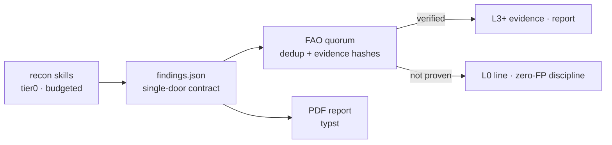

<div align="center">

# cyphron

**Proof, not claims.** An evidence-first security assessment engine —
Python skills driven by a native Rust core, one strict contract,
zero false positives by design.

*No exploit, no report.*

[](#development)
[](https://github.com/maulanawirawan/cyphron/actions/workflows/ci.yml)
[](LICENSE)
[](#quick-start)
[](#quick-start)
[](#whats-inside)

**English** · [Bahasa Indonesia](README.id.md) · [中文](README.zh.md) · [Español](README.es.md)

</div>

---

## Why cyphron exists

Most scanners hand you a wall of unverified findings and wish you luck.
Triage teams reject those reports — *"demonstrated impact is not clear"* —
and honestly, they're right.

cyphron optimizes for the opposite outcome: **a finding you cannot prove
is a lead, not a claim.** Every row carries a verdict on an explicit
evidence ladder, malformed output stops the run instead of passing
silently, and cross-tool correlation only upgrades a lead when
independent sources agree.

## The evidence ladder

| Level | Meaning | Reportable? |
|---|---|---|
| `L-x` | REJECTED (proven false positive) | — |
| `L0` | OBSERVED — checked, nothing found | no |
| `L1` | SUSPECTED — inventory/posture lead | no |
| `L2` | REPRODUCED — reproducible lead | no |
| `L3` | DETERMINISTICALLY VERIFIED — PoC | ✅ |
| `L4` | IMPACT VERIFIED — owned someone else's object | ✅ |
| `L5` | BLIND VALIDATED — third party confirmed | ✅ |

Only `L3+` can ever appear in a report. Everything else is internal
discipline: what you checked, and what it proved.



## What's inside

> **Public edition scope:** this public repository ships the
> detection/posture engine (read-only + bounded skills, evidence
> quorum, reports). Active-exploitation components are
> intentionally excluded and require a separate license.

- **84 registry skills** (recon, posture, exposure) — each with an
  explicit safety class (`read-only` → `state-changing`) and a hard
  request budget derived from it.
- **Public edition scope** — this repository ships the
  detection/posture engine only (read-only + bounded skills, quorum,
  reports). The gated active-exploitation tier (playbooks, lab target,
  sandbox) is intentionally **not** part of this repository.
- **Code map** — parses a target repo's source into an
  `attack-surface.json` (routes, auth flags, upload handlers) with
  zero requests and zero code execution, then reconciles leads to
  `file:line`.
- **Night runs** — scheduled scans with drift detection: new leads,
  weakened evidence, and verdict changes are tracked per program.
- **One contract, two languages** — `findings.json` is implemented
  identically in Python and Rust and cross-tested; the native core also
  brings FAO correlation (dedup, quorum, evidence hashes) and a request
  budget that fails closed.

## Quick start

```bash
# build the native core
cargo build --release --manifest-path core-rs/Cargo.toml

# run one skill directly
python skills/banner_posture.py --url https://example.com --out banner.json

# validate against the contract
core-rs/target/release/cyphron validate banner.json

# full tier0 scan (public-data only, strict budget) + PDF report
core-rs/target/release/cyphron scan --domain example.com \
    --max-requests 32 --out findings/scan --report
```

### Code map

```bash
# map a repo's source to an attack surface (zero requests)
python tools/code_map.py --repo <path> --out surface.json --reconcile f.json
```

## Design rules (the boring, important part)

- **Single-door contract** — every tool writes the same `findings.json`
  shape; malformed output fails the run (fail-closed).
- **Safety classes + registry allowlist** — tier0 only ever runs the
  gentle classes; the registry is an allowlist, not a blacklist.
- **Zero-FP regression battery** — FP1–FP16 plus per-class guards are
  part of the test suite; a control endpoint "failing too" cancels the
  claim instead of confirming it.
- **Low-profile egress** — honest tool identity by default; optional
  `--ua` / `--proxy` with redacted credentials. No evasion features,
  on purpose.
- **Run manifest** — sha256 of every artifact per run, so evidence
  chains stay verifiable later.

## Repo layout

```
core/findings.py        # the single-door contract (Python side)
core-rs/                # native core: contract, orchestrator, FAO, serve
skills/                 # 75 registry skills + registry.json (allowlist)
tools/                  # exploit engine/playbooks/sandbox, planner,
                        # code-map, nightrun, PDF report, MCP server…
tests/                  # Python suite (incl. FP regression + guards)
lab/                    # synthetic local lab site
docs/                   # exploit tier policy, egress, install, nightrun
Dockerfile              # slim product image
```

## MCP server (Claude Code / Cursor / any MCP client)

```bash
pip install "mcp[cli]"
```

```json
{
  "mcpServers": {
    "cyphron": {
      "command": "python",
      "args": ["tools/mcp_server.py"]
    }
  }
}
```

Exposes `cyphron_list_skills` and `cyphron_run_skill` — lab-only classes
are never exposed, and every result is contract-validated before it's
returned.

## FAQ

**Is this a vulnerability scanner?**
Partly. The tier0 side is a budgeted recon/posture engine. The more
interesting half is the exploit tier: turning "maybe" into "proven" with
reproducible PoCs — on targets you're authorized to test.

**Why so many "not proven" lines in the output?**
That's the point. A failed proof is recorded as an L0 line, not hidden.
Silent skips are how false positives are born.

**Can I point the exploit engine at a production site?**
You shouldn't — and the tool makes that a conscious, explicit act
(`exploit_allowed` per target, lab/staging intended). For anything
destructive you need three independent keys plus a snapshot.

## Development

```bash
python -m unittest discover -s tests
cargo test --release --manifest-path core-rs/Cargo.toml
```

Guard tests enforce the contract across languages: verdict tags, finding
ids, `(rows, meta)` return shapes, caller arity, anti-UA hardcoding, and
the FP regression battery.

## Scope & responsible use

cyphron is for **authorized** security assessment: your own assets, or
programs that explicitly grant permission. Scanning systems you do not
own without authorization is illegal in most jurisdictions — don't.

## License

[PolyForm Noncommercial 1.0.0](LICENSE) - free to use, study, modify, and
share for **noncommercial purposes**.

Selling Cyphron, or using it commercially (including offering it as a paid
service), requires a separate commercial license - contact the owner via
[GitHub issues](https://github.com/maulanawirawan/cyphron/issues) or
[@maulanawirawan](https://github.com/maulanawirawan).

Bundled third-party components and data sources are credited in
[THIRD-PARTY-NOTICES.md](THIRD-PARTY-NOTICES.md).
