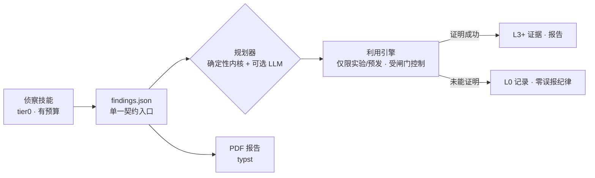

<div align="center">

# cyphron

**证据，而非空口主张。** 一个以证据为先的安全评估引擎 ——
Python 技能由原生 Rust 内核驱动，单一严格契约，
设计上零误报。

*No exploit, no report.*（未利用，不报告。）

[](#开发)
[](https://github.com/maulanawirawan/cyphron/actions/workflows/ci.yml)
[](LICENSE)
[](#快速开始)
[](#快速开始)
[](#包含什么)

[English](README.md) · [Bahasa Indonesia](README.id.md) · **中文** · [Español](README.es.md)

</div>

---

## 为什么要有 cyphron

大多数扫描器会丢给你一堵未经证实的发现之墙，然后祝你好运。
漏洞分类团队会拒绝这类报告 —— *"demonstrated impact is not clear"*
（未能证明实际影响）—— 说实话，他们没说错。

cyphron 追求的恰恰是相反的结果：**无法证明的发现只是线索，
而不是结论。** 每一条记录都带有明确的证据阶梯评级；
格式错误的输出会直接终止运行，而不是悄悄通过；
只有当多个独立来源一致时，跨工具关联才会升级线索。

## 证据阶梯

| 等级 | 含义 | 可否上报？ |
|---|---|---|
| `L-x` | 已否决（证实为误报） | — |
| `L0` | OBSERVED —— 已检查，无发现 | 否 |
| `L1` | SUSPECTED —— 资产/姿态线索 | 否 |
| `L2` | REPRODUCED —— 可复现线索 | 否 |
| `L3` | DETERMINISTICALLY VERIFIED —— PoC 证明 | ✅ |
| `L4` | IMPACT VERIFIED —— 实际读到他人对象 | ✅ |
| `L5` | BLIND VALIDATED —— 第三方确认 | ✅ |

只有 `L3+` 才可能进入报告。其余都是内部纪律：
检查了什么，证明了什么。



## 包含什么

- **75 个注册技能**（侦察、姿态、暴露面）—— 每个都有明确的安全
  等级（`read-only` → `state-changing`）以及由它推导出的硬性请求
  预算。
- **35 个利用手册（playbook）** —— IDOR、SQLi（布尔/报错/时间）、
  SSRF 及链式利用、XXE（OOB + 文件内联）、反序列化、JNDI、原型
  链污染、缓存欺骗**与缓存投毒**、JWT（弱密钥 + 算法混淆）、CRLF、
  用户枚举（重置 + 注册）、会话固定 + 登出后会话未失效、账户锁定、
  OAuth state、Host 头投毒、RCE 标记、批量 IDOR、API 版本间鉴权
  回归…… 每个手册都配有对应的**安全端点对照** —— 如果对照组也
  "失败"，该声明即被丢弃。
- **Docker 沙箱** —— 引擎运行在临时加固容器中（只读根文件系统、
  cap-drop ALL、内部网络、无互联网）。全部 35 个手册都在该沙箱
  内端到端验证通过 —— 140 个请求，零外部流量。
- **攻击规划器** —— 默认为确定性内核（零请求、零执行）；可选的
  本地 LLM 只能从已注册的手册菜单中*挑选与排序*，输出经严格校验。
  始终生成 `exploit_allowed: false`。
- **代码地图** —— 将目标仓库源码解析为 `attack-surface.json`
  （路由、鉴权标记、上传处理），零请求、零代码执行，并把线索
  对齐到 `file:line`。
- **夜间运行** —— 定时扫描 + 漂移检测：新线索、弱化证据、评级
  变化均按程序追踪。
- **一份契约，两种语言** —— `findings.json` 在 Python 和 Rust 中
  实现完全一致并交叉测试；原生内核还提供 FAO 关联（去重、仲裁、
  证据哈希）和会快速失败的请求预算。

## 快速开始

```bash
# 构建原生内核
cargo build --release --manifest-path core-rs/Cargo.toml

# 直接运行单个技能
python skills/banner_posture.py --url https://example.com --out banner.json

# 对照契约校验
core-rs/target/release/cyphron validate banner.json

# 完整 tier0 扫描（仅公开数据，严格预算）+ PDF 报告
core-rs/target/release/cyphron scan --domain example.com \
    --max-requests 32 --out findings/scan --report
```

### 利用层（仅限实验环境 —— 受闸门控制）

```bash
# 本地易受攻击的实验目标
python tools/lab_target.py &

# 对其运行手册 —— 配置中必须显式设置 exploit_allowed: true
python tools/exploit_engine.py --config exploit-lab.json --out findings/exploit

# 或者在加固的一次性沙箱中完成全部流程
python tools/exploit_sandbox.py --config exploit-lab.json \
    --out findings/exploit-sandbox --lab-in-docker
```

没有显式的 `exploit_allowed: true`，引擎会拒绝向目标发出哪怕一个
请求。破坏性模式需要三把钥匙同时具备，而"永不清单"（DoS、持久化、
蠕虫、勒索）无法被任何开关解锁。

### 规划器与代码地图

```bash
# 把线索变成攻击计划 —— 始终生成 exploit_allowed: false
python tools/attack_planner.py --findings f.json --out plan.json

# 把仓库源码映射为攻击面（零请求）
python tools/code_map.py --repo <path> --out surface.json --reconcile f.json
```

## 设计规则（枯燥但重要）

- **单一入口契约** —— 所有工具写入同一 `findings.json` 结构；
  格式错误即运行失败（快速失败）。
- **安全等级 + 注册表白名单** —— tier0 只运行温和类别；
  注册表是白名单，不是黑名单。
- **零误报回归套件** —— FP1–FP16 加各类守卫是测试套件的一部分；
  对照端点"也失败"会取消声明，而不是确认它。
- **低调出口** —— 默认诚实的工具身份；可选 `--ua` / `--proxy`，
  凭据已脱敏。刻意不提供任何规避功能。
- **运行清单** —— 每次运行所有工件的 sha256，确保证据链日后可验证。

## 仓库结构

```
core/findings.py        # 单一入口契约（Python 侧）
core-rs/                # 原生内核：contract、orchestrator、FAO、serve
skills/                 # 75 个注册技能 + registry.json（白名单）
tools/                  # 利用引擎/手册/沙箱、规划器、代码地图、
                        # 夜间运行、PDF 报告、MCP 服务器……
tests/                  # Python 测试套件（含误报回归 + 守卫）
lab/                    # 本地合成实验站点
docs/                   # 利用层策略、出口、安装、夜间运行
Dockerfile              # 精简产品镜像
```

## MCP 服务器（Claude Code / Cursor / 任意 MCP 客户端）

```bash
pip install "mcp[cli]"
```

```json
{
  "mcpServers": {
    "cyphron": {
      "command": "python",
      "args": ["tools/mcp_server.py"]
    }
  }
}
```

暴露 `cyphron_list_skills` 与 `cyphron_run_skill` —— 仅实验环境的
类别永远不会暴露，所有结果在返回前都经过契约校验。

## 常见问题

**这是一个漏洞扫描器吗？**
部分是。tier0 是有预算约束的侦察/姿态引擎。更有意思的一半是利用层：
在获授权的目标上，把"可能"变成"已证明" —— 带可复现的 PoC。

**为什么输出里有那么多 "not proven"（未证明）行？**
这正是重点。证明失败会记录为 L0 行，而不是被隐藏。
静默跳过正是误报的温床。

**能把利用引擎指向生产站点吗？**
不应该 —— 而且该工具把这件事变成一个有意识的显式动作
（按目标设置 `exploit_allowed`，面向实验/预发环境）。破坏性操作
需要三把独立钥匙外加快照。

## 开发

```bash
python -m unittest discover -s tests
cargo test --release --manifest-path core-rs/Cargo.toml
```

守卫测试跨语言维护契约：verdict 标签、finding id、`(rows, meta)`
返回结构、调用方参数数量、反 UA 硬编码，以及误报回归套件。

## 范围与负责任的使用

cyphron 仅用于**获授权的**安全评估：你自己的资产，或明确授权的
项目。未经授权扫描他人的系统在大多数司法辖区都是违法的 —— 请勿这样做。

## 许可证

[PolyForm Noncommercial 1.0.0](LICENSE) - free to use, study, modify, and
share for **noncommercial purposes**.

Selling Cyphron, or using it commercially (including offering it as a paid
service), requires a separate commercial license - contact the owner via
[GitHub issues](https://github.com/maulanawirawan/cyphron/issues) or
[@maulanawirawan](https://github.com/maulanawirawan).

Bundled third-party components and data sources are credited in
[THIRD-PARTY-NOTICES.md](THIRD-PARTY-NOTICES.md).
