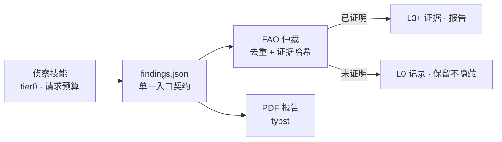

<div align="center">

# secai

**要证据，不要断言。**

一个以证据为先的安全评估引擎。检测技能用 Python 编写，核心是原生
Rust，两边遵守同一份严格的输出契约。

*无证据，不报告。*

[](https://github.com/maulanawirawan/secai/actions/workflows/ci.yml)
[](#包含什么)
[](https://github.com/maulanawirawan/secai/releases)
[](#包含什么)
[](#快速开始)
[](#快速开始)
[](LICENSE.md)

[English](README.md) · **中文** · [Español](README.es.md)

</div>

---

## 从你的 Agent 使用

secai 既是单命令多模式的 CLI，也提供可加载的 agent skill 与 MCP
服务器 —— Claude Code、Cursor 或任何能执行 shell 的 agent
都可以直接驱动它。

```bash
git clone https://github.com/maulanawirawan/secai && cd secai
python secai.py                          # 模式面板
python secai.py <mode> --help            # 查看某个模式的全部选项
claude mcp add secai -- python tools/mcp_server.py   # MCP（仅 tier0 白名单）
```

Agent 请先阅读 [SKILL.md](SKILL.md) —— 教 agent 安全驱动 secai 的
手册。仅限授权目标；无证明，不出报告。

## 为什么做 secai

大多数扫描器会丢给你几百条"可能存在"的问题，剩下的全靠你自己。
报告一交上去，分诊团队回一句"未证明影响"就退回了。说实话，他们没错。

secai 反其道而行：**证明不了的发现只是线索，不是结论。** 每条结果
都在一个明确的证据阶梯上有自己的位置。任何工具输出格式不对，整个运行
就会停下，而不是悄悄继续。只有当多个独立来源一致时，线索才会升级。

最后得到的报告更短，但每一条都站得住。

## 用途

secai 是面向真实安全工作的公开开源项目。典型用法：

- **漏洞赏金与 VDP** — 枚举攻击面（headers、CORS、GraphQL、API 文档、
  暴露面、Cookie 作用域），得到能通过分诊的判定，而不是一堆"可能有问题"。
- **对自己编码项目的渗透测试** — 在发布前把技能指向 staging/本地构建，
  抓住常见问题：缺失的安全头、调试页面、泄露文件、无鉴权端点、宽松 CORS。
- **把安全集成进流水线** — findings.json 契约与 `secai validate` 让输出
  适合 CI；Rust 核心说同一套契约。
- **学习** — 内置 lab 目标与 `docs/AWARENESS-PATTERNS.md`（九种真实漏洞
  模式的端到端剖析）是很好的实践课堂。

留在轨道上：只测自己拥有/获授权的目标，proof 层的严格门控是设计的一部分。

## 看它怎么判断

把一个 skill 指向自带的实验靶场，关注它给出的判定，而不是一堆"发现"。
下面是真实输出，原样复制（工具用印尼语打印：`temuan` = 发现，`AMAN` =
正常，`request` = 请求）：

```console
$ python tools/lab_target.py
lab target aktif: http://127.0.0.1:8777

$ python skills/http_security_headers.py \
    --url http://127.0.0.1:8777/api/products --from-raw raw.txt \
    --out headers.json
http-security-headers: 8 temuan (2 AMAN) (0 request) -> headers.json

$ secai validate headers.json
OK: 8 findings valid terhadap kontrak (headers.json)
```

再看看 `headers.json` 里到底是什么——每一行都带着自己的判定：

```
L1 SUSPECTED   low    Security header absent: Content-Security-Policy    reportable: false
L1 SUSPECTED   low    Security header absent: X-Frame-Options            reportable: false
L1 SUSPECTED   low    Security header absent: X-Content-Type-Options     reportable: false
L1 SUSPECTED   info   Security header absent: Referrer-Policy            reportable: false
L1 SUSPECTED   info   Security header absent: Permissions-Policy         reportable: false
L0 OBSERVED    info   No version leak via Server                         reportable: false
L0 OBSERVED    info   No version leak via X-Powered-By                   reportable: false
L1 SUSPECTED   low    Security headers posture: 0/5 present              reportable: false
```

注意没有发生的事：没有任何一条被称作漏洞。它们都是 `L1` 线索和 `L0`
（"查过了，没发现"）记录，每一条都标着 `reportable: false`，因为还没有
任何一条被证明。这正是重点。

## 证据阶梯

| 级别 | 含义 | 进入报告？ |
|---|---|---|
| `L-x` | REJECTED：已证实为误报 | 否 |
| `L0` | OBSERVED：已检查，未发现问题 | 否 |
| `L1` | SUSPECTED：资产或配置层面的线索 | 否 |
| `L2` | REPRODUCED：线索可复现 | 否 |
| `L3` | DETERMINISTICALLY VERIFIED：有可运行的 PoC | ✅ |
| `L4` | IMPACT VERIFIED：访问到了不属于你的对象 | ✅ |
| `L5` | BLIND VALIDATED：由第三方确认 | ✅ |

只有 `L3` 及以上才会出现在报告里。其余都是工作记录：查了什么，结果
如何。



## 包含什么

- **272 个能力脚本**，分两族：**93 个注册检测技能**（`skills/`，覆盖
  侦察、配置态势和暴露面 —— 每个都是独立 CLI，声明安全等级（从
  `read-only` 到 `state-changing`）并据此设定硬性请求上限；注册表是
  白名单，未登记的技能不会运行）+ **176 个离线工具**（`tools/`，证据
  分诊，其中 121 个移植自 995 个技能概念）。
- **原生 Rust 核心**（`core-rs/`）：`secai validate` 校验契约，
  `secai scan` 执行分级扫描，并生成 PDF 报告。它还负责 FAO 关联
  （去重、仲裁、证据哈希）以及失败即关闭的请求预算。
- **一份契约，两种语言。** `findings.json` 在 Python 和 Rust 中各有
  实现，并互相交叉测试。
- **自动更新的威胁情报**，来源为 CISA KEV、NVD 和 OSV，CVE 匹配不会
  过时。
- **代码地图。** 对一个代码库生成 `attack-surface.json`（路由、认证
  标记、上传处理器），零请求、零代码执行，并把线索对应到 `file:line`。
- **夜间运行。** 定时扫描并检测变化：新线索、证据减弱、结论变化都会
  按项目记录。
- **MCP 服务器**，可以从 Claude Code、Cursor 或任何 MCP 客户端驱动
  secai。
- **受控的证明层**（`tools/exploit_*`），用可复现的 PoC 把 `L1`/`L2`
  线索提升为 `L3`/`L4`。默认关闭，只有目标被显式标记为
  `exploit_allowed` 时才会启用，面向实验室和预发布环境。部分技术
  （DoS、持久化、蠕虫、勒索模拟、大规模数据外泄）无论什么参数都会被
  拒绝。详见 [docs/EXPLOIT-TIER.md](docs/EXPLOIT-TIER.md)。

在用 AI 编程助手？让它读 [AGENTS.md](AGENTS.md)，里面写了如何构建、
测试和添加技能。

## 能力图谱

triage 家族是一组独立的离线 CLI：输入证据（日志、导出、清单、二进制），输出确定性的 findings.json，fail-closed，零网络。按领域划分的亮点：

<details>
<summary><b>9 个领域共 96 个移植工具（tools/ 下共 175 个）— 点击展开</b></summary>
<br>

| 领域 | 回答的问题… | 示例 |
|:---|:---|:---|
| Windows 事件分诊 | 谁在横向移动 / 持久化 / 转储凭据？ | `sysmon_triage`, `win_persist_triage`, `dcsync_triage`, `ps_scriptlog_triage` |
| Linux 与主机加固 | 这台主机是否已加固 / 有后门 / 可提权？ | `linux_cis_audit`, `linux_persist_scan`, `linux_privesc_audit`, `aide_change_triage` |
| 云与容器配置 | 这个 bucket / 角色 / Pod / 函数是否暴露？ | `aws_config_audit`, `gcp_fw_audit`, `k8s_podsec_audit`, `netpol_audit`, `lambda_config_audit` |
| Web、API 与 OAuth | 这个 spec/流程/redirect/token 是否可被滥用？ | `openapi_spec_audit`, `graphql_depth_audit`, `oauth_redirect_audit`, `jwt_token_audit` |
| 恶意软件与二进制 | 这个二进制/文档能做什么，内嵌了什么？ | `pe_import_scan`, `rust_binary_triage`, `crypto_constant_scan`, `stego_triage`, `sqlite_forensics` |
| 机密与数据 | 泄露了什么、在哪里、有多严重？ | `paste_triage`, `secret_report_ingest`, `data_class_scan`, `browser_history_triage` |
| 供应链与 CI/CD | 这条流水线/provenance 可信吗？ | `gha_workflow_audit`, `slsa_provenance_audit`, `pkg_typosquat_check`, `sarif_ingest` |
| 漏洞管理 | 先修哪个，为什么？ | `ssvc_triage`, `owasp_risk_rating`, `attack_coverage`, `kev_gap` |
| 验证与报告 | 这个发现是真的吗，如何表述？ | `verify_gate`, `brocards_triage`, `log_chain_verify`, `report_pack` |

</details>

完整索引见 [CHANGELOG.md](CHANGELOG.md)；从非工具型概念提炼的方法论（250 节）见 [docs/PORT-AGENT-METHODS.md](docs/PORT-AGENT-METHODS.md)。

## 命令

| 命令 | 作用 |
|:---|:---|
| `secai scan --domain example.com --max-requests 32 --report` | 完整 tier0 扫描（仅公开数据，严格预算）+ PDF 报告 |
| `secai validate findings.json` | 用 Rust 核心校验任何 findings.json 是否符合契约 |
| `secai merge --dedup-id ...` | 合并并去重发现集（FAO 关联） |
| `python skills/<skill>.py --url … --out f.json` | 运行 93 个注册检测技能之一（注册表白名单管理） |
| `python tools/code_map.py --repo <path> --out surface.json` | 把代码库映射为攻击面 —— 零请求 |
| `python tools/chain_planner.py --findings f.json` | 从已有发现规划 A→B→C 利用链 |
| `python tools/submission_gate.py --finding f.json --program p.json` | 对单个发现执行提交前七问门禁 |
| `claude mcp add secai -- python tools/mcp_server.py` | 从 Claude Code / 任意 MCP 客户端驱动 secai |
| `python tools/lab_target.py` | 启动本地靶场练习 |

夜间运行（定时扫描 + 漂移检测）与情报同步（CISA KEV / NVD / OSV）见 [docs/](docs/)。

## 快速开始

```bash
# 构建原生核心
cargo build --release --manifest-path core-rs/Cargo.toml

# 运行单个技能
python skills/banner_posture.py --url https://example.com --out banner.json

# 按契约校验输出
core-rs/target/release/secai validate banner.json

# 完整 tier0 扫描（仅公开数据，严格预算）并生成 PDF 报告
core-rs/target/release/secai scan --domain example.com \
    --max-requests 32 --out findings/scan --report
```

想找个安全的练习目标？`python tools/lab_target.py` 会启动一个本地
实验靶场。更多安装说明见 [docs/INSTALL.md](docs/INSTALL.md)。

### 代码地图

```bash
# 把仓库源码映射为攻击面（不发送任何请求）
python tools/code_map.py --repo <path> --out surface.json --reconcile f.json
```

## 设计原则

枯燥，但最重要。

- **单一入口契约。** 所有工具写出同样结构的 `findings.json`，格式
  错误会让运行失败。
- **安全等级与白名单。** tier0 只运行温和的等级。不在注册表里的技能
  不会运行。
- **误报回归测试集。** FP1 到 FP16 以及各等级的守卫测试都在测试套件
  中。如果对照端点以同样方式"失败"，该结论会被撤销而不是被确认。
- **诚实的出站流量。** 默认如实标识自己。可以设置 `--ua` 或 `--proxy`
  （凭据会被脱敏），但刻意不提供任何规避功能。
- **运行清单。** 每次运行的每个产物都有 sha256，几个月后证据链依然
  可以核验。

## 仓库结构

```
core/findings.py   契约（Python 端）
core-rs/           原生核心：契约、编排器、FAO、serve
skills/            93 个注册检测技能 + registry.json
tools/             规划器、代码地图、夜间运行、情报同步、
                   PDF 报告、MCP 服务器、受控证明层、实验靶场
tests/             Python 测试套件，含误报回归与守卫测试
lab/               本地合成实验站点
docs/              安装、出站、夜间运行、情报、证明层策略
Dockerfile         精简镜像
```

## MCP 服务器

```bash
pip install "mcp[cli]"
```

```json
{
  "mcpServers": {
    "secai": {
      "command": "python",
      "args": ["tools/mcp_server.py"]
    }
  }
}
```

对外提供 `secai_list_skills` 和 `secai_run_skill`。仅限实验室的
等级永远不会暴露，每个结果在返回前都会按契约校验。

## 常见问题

**这是漏洞扫描器吗？**
部分是。tier0 是带预算的侦察和态势引擎，也是大多数人会用到的部分。
更有意思的是之后的环节：分清哪些真正被证明了，哪些还只是猜测。

**为什么输出里有那么多"未证明"？**
这是有意为之。没有证明出任何东西的检查会记为一条 `L0`，而不是消失。
误报往往就出在那些悄无声息的跳过上。

**可以把证明层用在生产环境吗？**
请不要。工具要求这必须是一个有意识的决定：每个目标都要设置
`exploit_allowed`，任何破坏性操作都需要三把独立的钥匙外加快照确认。

## 开发

```bash
python -m pytest tests/ -q
cargo test --release --manifest-path core-rs/Cargo.toml
```

守卫测试让两种语言保持一致：结论标签、发现 ID、`(rows, meta)` 返回
结构、调用参数个数、禁止硬编码 User-Agent，以及完整的误报回归测试集。

## 负责任地使用

secai 仅用于**已授权**的测试：你自己的系统，或明确给予许可的项目。
未经许可扫描他人系统在大多数地方都是违法的。请不要这样做。

## 社区

🐛 **发现 bug？** → [bug 报告](.github/ISSUE_TEMPLATE/bug_report.md)
🙅 **检测器误报了？** → [误报报告](.github/ISSUE_TEMPLATE/false_positive.md) — 误报报告在这里是一等公民，每一份都会收紧反误报底线
💡 **缺少某项能力？** → [功能请求](.github/ISSUE_TEMPLATE/feature_request.md)
🔒 **secai 本身的安全问题？** → [SECURITY.md](.github/SECURITY.md)（私下披露，不要开公开 issue）
🤝 [贡献指南](CONTRIBUTING.md) · [行为准则](.github/CODE_OF_CONDUCT.md) · [更新日志](CHANGELOG.md)

## 贡献

欢迎 PR：修 bug、新的检测技能、文档、错别字都行。从
[CONTRIBUTING.md](CONTRIBUTING.md) 开始。合并的 PR 会让你进入贡献者
列表。

如果 secai 帮你省了时间，点个 ⭐ 能让更多人发现它。

## Star History

[](https://star-history.com/#maulanawirawan/secai&Date)

## 致谢

- [Agentic-Bug-Hunter](https://github.com/awarexone/Agentic-Bug-Hunter)（MIT）—— scope/chain/web3/记忆/报告 小型移植计划的概念来源（`scope_gate`、`chain_planner`、`solidity_static_audit`、`hunt_pattern_db` 等）。
- 995 概念移植计划使用了四个公开安全 skill 集合（trailofbits/skills、SnailSploit/Claude-Red、mukul975/Anthropic-Cybersecurity-Skills、NVIDIA-SkillSpector）—— 每个工具均为从头实现，docstring 中注明概念出处。

## 许可证

[PolyForm Noncommercial 1.0.0](LICENSE.md)。可在**非商业**用途下自由
使用、学习、修改和分享。

想商用，比如集成进付费服务？也可以，先问一声，我们来商量授权。可以开
一个 [issue](https://github.com/maulanawirawan/secai/issues) 或联系
[@maulanawirawan](https://github.com/maulanawirawan)。

第三方组件和数据来源见
[THIRD-PARTY-NOTICES.md](THIRD-PARTY-NOTICES.md)。
